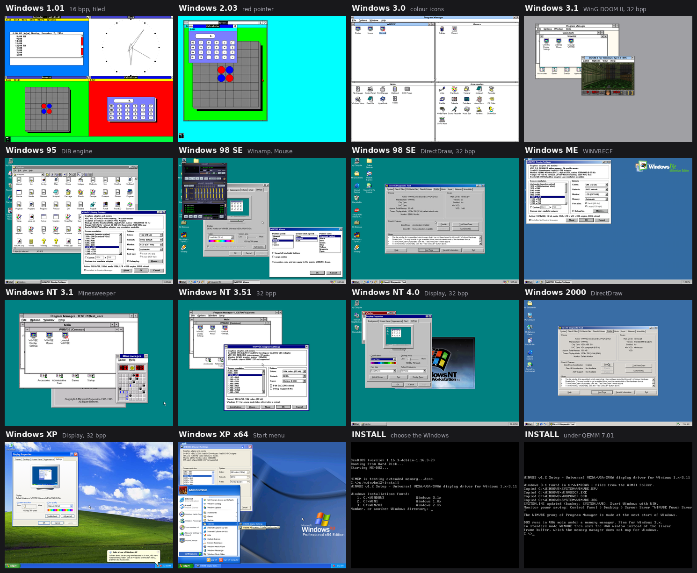

# WINVBE

**One display driver for every Windows from 1.01 to XP x64.**

WINVBE is a universal display driver that drives the graphics card through
its **VESA BIOS Extensions (VBE)** instead of card-specific code, in the
spirit of VBEMP and VBESVGA. The same package runs Windows 1.0x, 2.x, 3.0,
3.1, Windows for Workgroups, Windows 95/98/ME and the Windows NT family up to
XP and Server 2003 x64, at resolutions up to 4096x4096 and colour depths up
to 32 bit. It works with any card that has a VBE BIOS, from an S3 Trio to a
GeForce or Radeon booted with CSM, and with the virtual cards of QEMU, Bochs,
VirtualBox and VMware.




---

## Contents

- [What's new in 1.2](#whats-new-in-12)
- [Highlights](#highlights)
- [Supported systems](#supported-systems)
- [Requirements](#requirements)
- [Package contents](#package-contents)
- [Installation](#installation)
- [Shortcuts and uninstalling](#shortcuts-and-uninstalling)
- [Settings](#settings)
- [Windows 95, 98 and ME](#windows-95-98-and-me)
- [Windows NT](#windows-nt)
- [NONPNP: VGA.SYS replacement for Windows NT](#nonpnp-vgasys-replacement-for-windows-nt)
- [Power management](#power-management)
- [915PATCH: resolutions for Intel integrated graphics](#915patch-resolutions-for-intel-integrated-graphics)
- [Hardware notes](#hardware-notes)
- [Performance notes](#performance-notes)
- [Known limitations](#known-limitations)
- [Troubleshooting](#troubleshooting)
- [Test programs](#test-programs)
- [Building from source](#building-from-source)
- [Repository layout](#repository-layout)
- [Testing](#testing)
- [Changelog](#changelog)
- [License](#license)

## What's new in 1.2

- **Windows 95/98/ME run WINVBE as a DIB engine driver**, like their own
  display drivers. DirectDraw (DXDIAG's tests, games, video players), WinG,
  DIB sections and Video for Windows work at full speed, and **resolution
  and colour depth can be changed in Display Properties live**, without a
  reboot - both the resolution and, with *Apply the new color settings
  without restarting*, the colour depth. WINVBECF applies a
  resolution/depth-only change live as well.
- **Many fixes for Windows 98 on real notebooks and desktops**: 256-colour
  skins (Winamp), black Device Manager icon backgrounds, black AVS
  visualisations at 32 bpp, the DXDIAG DirectDraw hang, black copy/move
  animations and more.
- **A DirectDraw HAL on Windows 95/98/ME** (`WVBDD32.DLL`): blits, fills,
  stretches and colour keys in video memory, **YUV video surfaces** (YUY2,
  UYVY, YV12) with colour conversion, an **emulated overlay**, and page
  flipping (the display start on Bochs, QEMU and VirtualBox, a copy
  elsewhere). Video players get the YUV paths DirectDraw's own emulation
  does not have.
- **A Direct3D HAL on Windows 95/98/ME, 2000 and XP**: WINVBE's own
  fixed-function rasterizer (DirectX 6 and 7 driver interface,
  DrawPrimitives2) renders into video memory: Gouraud shading, up to four
  texture stages with perspective correction, mipmaps and bilinear
  filtering, DXT textures, Z/W buffers and stencil, fog, alpha test and
  blending. Programs see a *Direct3D HAL* device and a 3D-capable display.
- **An OpenGL ICD** (`WVBGL32.DLL`, Windows 95/98/ME, NT 3.1, 3.5, 3.51,
  4.0, 2000, XP, and 64-bit as well as 32-bit programs on XP x64): OpenGL
  2.1 with GLSL 1.20
  and 137 extensions in software (the Mesa 7.8.2 rasterizer). Programs
  that refuse Microsoft's *GDI Generic* OpenGL 1.1, or need multitexturing
  or shaders, run. On 32-bit Windows it uses an **SSE2 build** where the
  CPU and the operating system allow it (also Windows 95 and NT 4.0 with
  [WINSIMD](https://github.com/ages2001/winsimd)), about three times as
  fast, and the x87 build on every other PC.
- **Full OpenGL 2.1 on Windows NT 3.1, 3.5 and 3.51.** NT 3.5x's own
  OpenGL is 1.0 and NT 3.1 has none; WINVBE ships an `OPENGL32.DLL` that
  gives all three the same OpenGL 2.1 as NT 4.0+. On NT 3.1, whose GDI32
  predates OpenGL, `WVGDI.DLL` and the `GL31PAT.EXE` patcher let an OpenGL
  program load and run (verified: the ICD test's 31 checks, GLSL shader
  included, all pass).
- **Gamma ramps on Windows 98/ME**: `SetDeviceGammaRamp` and DirectDraw's
  `IDirectDrawGammaControl` (games' brightness sliders) in 256 colours,
  and in high and true colour without the DIB engine.
- **Gamma, brightness and contrast**, **screen rotation** and **scaled
  small modes** on Windows 3.x and 9x (*WINVBE Colors and Screen*) and on
  Windows NT (*Display features*, with a shadow frame buffer).
- **True-colour icons on Windows 3.0** (Program Manager) and in **Windows
  NT 3.1** programs such as Minesweeper.
- **WINVBE Mouse** for every Windows: pointer speed, double-click speed,
  swapped buttons and the colour and size of the pointer WINVBE draws.
- **Shortcuts**: the installation creates a WINVBE group (Program Manager)
  or Start menu folder with *WINVBE Display Settings*, *WINVBE Mouse* and,
  where Windows has no *Add/Remove Programs*, *Uninstall WINVBE*.
- The DOS installer lists the Windows installations it finds and asks
  which one to use.
- Windows 3.x standard mode under JEMM386, JEMMEX, HIMEMX, QEMM, UMBPCI and
  EMM386 ([issue #2](https://github.com/ages2001/WINVBE/issues/2)).
- **NONPNP**: a stand-alone replacement for Windows NT's `VGA.SYS` that
  starts Windows NT 4.0, 2000 and XP (x86 and x64) in 800x600 with 64K
  colours with Windows' own frame buffer driver, for PCs whose standard
  VGA does not work. See
  [NONPNP](#nonpnp-vgasys-replacement-for-windows-nt).
- Tested on more systems: Windows ME, NT 3.51, NT 4.0, XP, 2000 on an AHCI
  disk, QEMM 7.01 and 7.5.

Details are in the [changelog](#changelog).

## Highlights

- **Every resolution the BIOS offers.** 640x480 through 3840x2160 and
  beyond, 8/15/16/24/32 bpp, LFB or the banked VGA window (chosen
  automatically). On Bochs, QEMU and VirtualBox adapters any custom size
  is available too.
- **Looks like Windows.** The standard mouse pointers, icons and window
  bitmaps of each version: the drivers carry the ones of Microsoft's own
  VGA driver for Windows 1.01, 2.x, 3.0, 3.1 and NT 3.x, while Windows
  95/98/ME and NT 4.0+ use their built-in ones. Colour icons on every
  version that has them, including Windows 3.0.
- **Monitor aware.** It reads EDID over VBE/DDC to get the monitor name,
  native resolution and refresh range, and *Automatic* picks the native
  mode. With a VBE 3.0 BIOS you can set the refresh rate (CVT or
  reduced-blanking timings).
- **Windows 9x like a native driver.** DIB engine mode with a DirectDraw
  HAL (YUV surfaces, overlay, page flipping) and changes of resolution and
  colour depth from Display Properties.
- **A VGA.SYS that needs no VGA** (NONPNP): Windows NT 4.0, 2000 and XP
  start in 800x600 with 64K colours even before WINVBE is installed.
- **Fast on modern cards.** A shadow frame buffer in system memory (Windows
  3.x) removes the very slow PCIe reads from video memory, and write
  combining (PAT or MTRR, set up by `WINVBE.386`) sends frame buffer
  writes as bursts.
- **No Windows disks needed.** A DOS installer finds the Windows
  installations on the hard disks and installs the matching driver, even
  linking it into `WIN100.BIN`/`WIN200.BIN` for Windows 1.x/2.x.
  OEMSETUP.INF files are included for every Setup that accepts one.
- **Full-screen and windowed MS-DOS boxes**, including the screen switches
  of real cards that the standard VGA virtual display device knows nothing
  about.
- **Windows NT family.** A video miniport plus a frame buffer display
  driver for NT 3.1 - XP, plus a 64-bit build for XP/2003 x64. Cards
  without a linear frame buffer (VBE 1.2, ISA/VL-Bus, many 86Box/PCem
  cards) use the banked VGA window. Features:
  - DirectDraw with page flipping
  - a Direct3D HAL (2000/XP) and an OpenGL 2.1 ICD (NT 3.1 and later),
    in software
  - DPMS, Stand By and Hibernate
- **Power management** on 3.x/9x/ME: DPMS stand-by/off through VBE/PM
  (WINVBE Power Saver screen saver) and the mode is restored after
  APM/ACPI suspend.
- **VMware SVGA II**: host-accelerated copies and fills, any True Color
  resolution, and the host's hardware mouse pointer (Windows 3.x).
- **915PATCH** adds the missing panel/monitor resolutions to the video
  BIOS of Intel 830 ... G45/GM45 and Atom graphics, like `915resolution`.
  It comes as a DOS program, as a VxD and built into the NT miniport.
- **WINVBECF**, one settings program per platform (resolution, colours,
  refresh, memory access, font size, debug log), and **WINVBE Mouse**.

## Supported systems

| Windows | Driver | Install with |
|---|---|---|
| 1.01 - 1.04 | `WIN1X\WINVBE.DRV` (real mode) | `INSTALL.EXE`, or patched Setup disks |
| 2.03, 2.1x, Windows/386 2.x | `WIN2X\WINVBE.DRV` | `INSTALL.EXE`, or Setup → *Other* |
| 3.0 (real, standard, 386 enhanced) | `WIN30\WINVBE.DRV` + `WINVBE.386` | `INSTALL.EXE`, DOS Setup → *Other* |
| 3.1, WfW 3.1/3.11 | `WIN31\WINVBE.DRV` + `WINVBE.386` | `INSTALL.EXE`, Setup, or WINVBECF |
| 95, 98, ME | `WIN9X\WINVBE.DRV` + `WINVBE.386` | Device Manager → *Have Disk* |
| NT 3.1, 3.5, 3.51 | `NT\I386\NT3X` miniport + CSRSS display DLL | WINVBECF, or OEMSETUP.INF |
| NT 4.0, 2000, XP, Server 2003 | `NT\I386\NT4-XP` | WINVBECF, *Have Disk*, Device Manager |
| XP x64, Server 2003 x64 | `NT\AMD64` | WINVBECF, Device Manager |
| NT 3.1 - XP/2003, x86 and x64 | `NONPNP\I386`, `NONPNP\AMD64`: `VGA.SYS` replacement (not WINVBE) | copy over `VGA.SYS` |

## Requirements

- A graphics card with a **VBE BIOS** (1.2, 2.0 or 3.0). On modern PCs,
  enable **CSM / Legacy boot**: UEFI-only (GOP) firmware has no VBE.
- Turn off **Above 4G decoding / Resizable BAR** where possible. Windows
  3.x/9x cannot reach a frame buffer above 4 GB. WINVBE detects this and
  falls back to the slower VGA window.
- A 386 or later CPU.
- Windows 1.x/2.x run in real mode, so the BIOS must support banked modes
  there.

## Package contents

```
INSTALL.EXE    DOS installer / configurator for Windows 1.0x - 3.11
915PATCH.EXE   DOS tool that adds resolutions to the video BIOS of Intel
               integrated graphics (like 915resolution on Linux)
915PATCH.VXD   the same, run by Windows while it starts (SYSTEM.INI)
GDITEST.EXE    16-bit GDI test program
README.md      this documentation, with docs\images\
LICENSE        GNU General Public License v3
MESA.TXT       the license of the Mesa code in WVBGL32.DLL (MIT)
WIN31\         Windows 3.1 / WfW: WINVBE.DRV, WINVBE.386 (helper VxD),
               WINVBECF.EXE (settings, WINVBE Mouse), WVBPOWER.SCR (monitor
               power saver), WVB*.FON (large system fonts), OEMSETUP.INF
               and the Microsoft files Setup would ask the disks for
WIN30\         the same for Windows 3.0 (with the Windows 3.0 files)
WIN9X\         Windows 95/98/ME: WINVBE.INF (Device Manager), WINVBE.DRV,
               WVBDD32.DLL (DirectDraw/Direct3D HAL), WVBGL32.DLL (OpenGL
               ICD) with WVBGLS.DLL (its SSE2 renderer) and WVBGLX.DLL
               (x87 renderer), WINVBE.386, WINVBECF.EXE, WVBPOWER.SCR,
               915PATCH.VXD
WIN2X\         Windows 2.x and Windows/386: WINVBE.DRV, WINVBECF.EXE,
               WINVBE.LGO (start-up logo), WINVBE.GRB, PREP2X.BAT
WIN1X\         Windows 1.0x: WINVBE.DRV, WINVBECF.EXE, WINVBE.LGO,
               PATCH1X.BAT
NT\I386\NT3X\    NT 3.1, 3.5, 3.51: WINVBE.SYS, WINVBE.DLL, WINVBECF.EXE,
                 WVBGL32.DLL, WVBGLS.DLL, WVBGLX.DLL (OpenGL ICD),
                 OEMSETUP.INF; GL\ OPENGL32.DLL (full OpenGL 2.1 for
                 programs on NT 3.1/3.5x), and for NT 3.1 WVGDI.DLL +
                 GL31PAT.EXE + README.TXT
NT\I386\NT4-XP\  NT 4.0, 2000, XP, Server 2003: WINVBE.SYS, WINVBE.DLL,
                 WINVBECF.EXE, WVBGL32.DLL (OpenGL ICD, with WVBGLS.DLL
                 and WVBGLX.DLL), WINVBE.INF
NT\AMD64\        XP / Server 2003 x64: the same files, 64 bit; WVBGL32.DLL
                 is the 64-bit OpenGL ICD, WVBGL32W.DLL the 32-bit one
                 (installed as SysWOW64\WVBGL32.DLL, with WVBGLS.DLL and
                 WVBGLX.DLL)
NONPNP\I386\    VGA.SYS: replacement for Windows NT's standard VGA driver
                 (NT 3.1 - XP / Server 2003, x86); not needed for WINVBE
NONPNP\AMD64\   VGA.SYS: the same for XP / Server 2003 x64
TEST\          Win32 test programs (see Test programs)
SRC\           complete source code and build scripts
```

The WIN30, WIN31 and WIN2X folders contain Microsoft files (fonts, screen
grabbers, `VDDVGA30.386`, `WIN.CNF`) so that no Windows disks are needed.
They belong to Microsoft Windows and are only meant for use with your own
licensed copy of Windows; do not redistribute them. The same applies to
the standard Windows bitmaps, cursors and icons inside the drivers.

## Installation

Download the release archive and copy the `WINVBE12` folder to the hard
disk, e.g. `C:\WINVBE12`.

### Windows 1.x, 2.x, 3.0, 3.1 and Windows for Workgroups: DOS installer

Exit Windows and run

```
C:\WINVBE12\INSTALL
```

INSTALL looks for Windows in the folders of the hard disks (one level, e.g.
`C:\WINDOWS`, `C:\WIN30`, `D:\WIN31`), lists what it finds and asks which
one to install for:

```
Windows installations found:
   1. C:\WINDOWS               Windows 3.1x
   2. C:\WIN1                  Windows 1.0x
   3. C:\WIN203                Windows 2.xx
Number, or another Windows directory: _
```

Another directory can be typed instead (e.g. `E:\OLD\WIN30`). INSTALL
recognises the version (Windows 1.0x, 2.xx, 3.0, 3.1x, Windows for
Workgroups; 95/98/ME and NT are sent to their own installers) and takes the
files of the matching folder. It then lists the video modes and the monitor
data and asks for the mode, refresh rate and font size. Start Windows with
`WIN`.

Unattended use:

```
INSTALL /W:1024 /H:768 /D:16 [/R:75] [/A:0|1|2] [/LARGE] [/DIR:C:\WIN31]
INSTALL /AUTO      monitor native mode
INSTALL /LIST      show modes and monitor information only
INSTALL /VGA       switch back to the original display driver
```

What INSTALL does:

- **Windows 3.x:** copies `WINVBE.DRV` and the WVB fonts to the SYSTEM
  directory and `WINVBECF.EXE` to the Windows directory, and updates
  `SYSTEM.INI` (the original is kept once as `SYSTEM.WVB`). VGA fonts and
  grabbers that Windows does not have yet are copied from the WIN30/WIN31
  folder. In 386 enhanced mode it adds `device=winvbe.386` to `[386Enh]`
  and, on Windows 3.1, copies `WVBPOWER.SCR`. It puts `WINVBECF.EXE` into
  `WIN.INI` `run=` once, which creates the [shortcuts](#shortcuts-and-uninstalling)
  at the next start of Windows.
- **Windows 1.x/2.x:** the display driver is part of `WIN100.BIN` /
  `WIN200.BIN` (built by Windows Setup). INSTALL links `WINVBE.DRV` into
  these files itself - no Setup, no disks - copies `WINVBECF.EXE` and
  writes the settings to `WIN.INI` `[WINVBE]`. The files of the last
  Windows Setup are kept as `WIN100.BAK/.OBK` or `WIN200.BAK/.OBK`;
  `INSTALL /VGA` puts them back. Windows/386 2.x is handled the same way
  (start it with `WIN386`).
- **Intel integrated graphics** whose video BIOS lacks the monitor
  resolution: INSTALL also sets up 915PATCH (`AUTOEXEC.BAT`), see
  [915PATCH](#915patch-resolutions-for-intel-integrated-graphics).
- **Memory managers:** INSTALL says whether DOS runs under one (EMM386,
  QEMM, JEMM386/JEMMEX ...) and what that means for Windows 3.x, see
  [Known limitations](#known-limitations).

### Windows 3.x from inside Windows

Run `WINVBECF.EXE` from the WIN31 or WIN30 folder (File > Run in Program
Manager), tick *Use WINVBE as the display driver*, choose the settings and
press OK. The files are copied and Windows restarts.

### Windows 3.x Setup (OEMSETUP.INF)

- **Windows 3.1:** run `SETUP` from DOS in the Windows directory, or
  Windows Setup (Main > Windows Setup > Options > Change System Settings).
  Display → *Other display (Requires disk from OEM)*, path: the WIN31
  folder (e.g. `C:\WINVBE12\WIN31`). Choose a colour depth / font size.
  All files Setup needs are in the folder; it installs `VDDVGA30.386` +
  `WVB30.3GR` (the VGA grabber pair for Windows 3.0 style display
  drivers). DOS Setup builds `WIN.COM` without the start-up logo.
- **Windows 3.0:** only the DOS Setup has the *Other* entry. Run `SETUP` in
  the Windows directory, Display → *Other (Requires disk provided by a
  hardware manufacturer)*, path: the WIN30 folder. Windows 3.0 Setup
  cannot write extra settings, so choose resolution and colours afterwards
  in `WINVBECF.EXE` (run it from the WIN30 folder once; it copies itself
  to the Windows directory).

### Windows 2.x and Windows/386 with Setup (optional)

INSTALL is the easy way. To use Setup's *Other* display choice instead,
run `SETUP` from the Windows 2.x Setup disk, choose *Other (requires disk
provided by a hardware manufacturer)* and type `C:\WINVBE12\WIN2X` (the
folder holds `WINVBE.DRV`, `WINVBE.LGO` and the grabber `WINVBE.GRB`).
Windows/386 Setup also wants `WINVBE.3EX` and `WINVBE.386` from your own
Windows/386: run `PREP2X C:\WIN386` (or `PREP2X A:`) in the WIN2X folder.
Windows/386 also needs a `CONFIG.SYS` without `DOS=HIGH`.

### Windows 1.0x with Setup (optional)

INSTALL is the easy way. Windows 1.0x Setup has a fixed display list and no
*Other* choice; `PATCH1X` puts WINVBE in the place of *EGA (more than 64K)
with Enhanced Color Display* on **copies** of the Setup and Build disks
(`PATCH1X A:` for each copy, then run SETUP from the copies).

On MS-DOS 5 or later, Windows 1.0x cannot start programs unless DOS
reports an older version: add `DEVICE=C:\DOS\SETVER.EXE` to `CONFIG.SYS`
and run `SETVER WIN100.BIN 3.30` once (INSTALL reminds you). The mouse
driver of Windows 1.0x supports Microsoft serial and bus mice, not PS/2
mice.

### Windows 95, 98 and ME: Device Manager

INSTALL refuses these versions; the driver is installed with Device
Manager:

1. Control Panel > System > Device Manager > *Display adapters* > your
   adapter (e.g. *Standard Display Adapter (VGA)*) > Properties > Driver >
   *Change Driver* (98/ME: *Update Driver*, "Display a list of all the
   drivers ...") > *Have Disk*, and give the `WIN9X` folder.
2. Choose **WINVBE Universal VESA/VGA/SVGA** and restart.
3. Set resolution and colours in *Display Properties* (see
   [Windows 95, 98 and ME](#windows-95-98-and-me)) or with `WINVBECF.EXE`,
   which also covers refresh rate, memory access and custom sizes.

The INF also installs `WINVBE.386`, the [shortcuts](#shortcuts-and-uninstalling)
and, on Intel graphics whose video BIOS 915PATCH can patch, `915PATCH.VXD`.

### Windows NT: WINVBECF or the INF

Log on as Administrator and use the folder for your system:

| Folder | Systems |
|---|---|
| `NT\I386\NT3X` | NT 3.1, 3.5, 3.51 |
| `NT\I386\NT4-XP` | NT 4.0, 2000, XP, Server 2003 |
| `NT\AMD64` | XP x64, Server 2003 x64 |

- **All versions:** run `WINVBECF.EXE` from the folder, press **Install
  driver**, then restart. On NT 3.x/4.0 WINVBECF copies the files, creates
  the winvbe service (the old display service is disabled; NT 3.1 keeps
  VGA for WOW and full-screen DOS) and sets 800x600, 16 bit. On 2000/XP/2003
  it installs `WINVBE.INF` for the display adapter (Plug and Play).
- **2000 / XP / 2003 / x64:** alternatively Device Manager > Display
  adapters > *Update Driver* > Install from a specific location > Don't
  search > *Have Disk* > the folder.
- **NT 4.0:** alternatively Display > Settings > *Display Type* > *Change* >
  *Have Disk* > `NT\I386\NT4-XP`.
- **NT 3.1:** alternatively Windows NT Setup > Options > *Change System
  Settings* > Display > *Other* > `NT\I386\NT3X` (OEMSETUP.INF), and choose
  a resolution. **NT 3.5/3.51:** Control Panel > Display > *Change Display
  Type* > *Change* > *Other* > `NT\I386\NT3X`.

WINVBECF keeps the display entry of NT 3.x Setup ("WINVBE VESA 1024 x 768,
16 bit ...") in step with the mode it sets.

If Windows NT does not start at all with its standard VGA driver (so that
WINVBE cannot be installed), see
[NONPNP](#nonpnp-vgasys-replacement-for-windows-nt).

## Shortcuts and uninstalling

Every installation path creates the shortcuts once:

| Windows | Where | Items |
|---|---|---|
| 3.0, 3.1, WfW | Program Manager group *WINVBE* | WINVBE Display Settings, WINVBE Mouse, Uninstall WINVBE |
| NT 3.1, 3.5, 3.51 | Program Manager common group *WINVBE* | WINVBE Display Settings, WINVBE Mouse, Uninstall WINVBE |
| 95, 98, ME | Start menu > Programs > *WINVBE* | WINVBE Display Settings, WINVBE Mouse |
| NT 4.0, 2000, XP, 2003, x64 | Start menu > (All) Programs > *WINVBE* | WINVBE Display Settings, WINVBE Mouse |

Windows 3.0 shows the short titles *Display*, *Mouse* and *Uninstall*,
because its Program Manager does not wrap icon titles. Windows 1.x/2.x have
no Program Manager: run `WINVBECF.EXE` from the MS-DOS Executive.

*Uninstall WINVBE* is offered only where Windows has no *Add/Remove
Programs*: on Windows 3.x it switches Windows back to the standard VGA
driver and VGA fonts, removes the group and offers to restart Windows; on
NT 3.x it disables the winvbe service, enables VGA again and offers to
restart. Elsewhere use Device Manager (95/98/ME, 2000 and later:
choose another display driver), Display > *Change Display Type* (NT 4.0),
or `INSTALL /VGA` from DOS (1.x - 3.x).

To create the shortcuts by hand, run `WINVBECF /SETUP`.

## Settings

### WINVBECF (WINVBE Display Settings)

`WINVBECF.EXE` shows the adapter (VBE version, memory, OEM name) and the
monitor (EDID name, native mode, frequency range), lists the modes and
sets:

| Setting | Choices |
|---|---|
| Screen resolution | Automatic (monitor native), 320x200 VGA, every VBE resolution; *Custom* on Bochs/QEMU/VirtualBox |
| Colors | 256 / 32K / 64K / 16M (24 bit) / 16M (32 bit) |
| Refresh | BIOS default, monitor native, 56 ... 120 Hz (VBE 3.0 BIOS) |
| Monitor | CRT (VESA CVT) or LCD (CVT reduced blanking) |
| Memory | Automatic / Linear (LFB) / VGA window |
| Font size | Small (96 dpi) / Large (120 dpi) |
| Debug log | driver log to port E9h or a serial port |
| Colors... | *WINVBE Colors and Screen*: gamma, brightness, contrast, turning, scaling of small resolutions (see below) |

Its *Active* line shows how the screen is driven, for example
`1024x768, 32 bit, mode 118h, LFB + DIB engine, BIOS refresh` (Windows 9x)
or `linear frame buffer + WC + shadow` (Windows 3.x).

On Windows 95/98/ME a change of resolution and/or colour depth alone (no
other start-time setting changed, and not the 320x200 VGA mode) is applied
**live**, through `ChangeDisplaySettings`, the moment you press OK - no
reboot and no "restart Windows?" prompt. Changing a setting that the driver
reads only when Windows starts (refresh, timing, memory, font size, the
debug log, or installing the driver) still asks to restart. On Windows NT
4.0 and later the change is likewise live; on Windows 3.x, Windows 2.x and
NT 3.x it takes effect at the next (Windows) start, as before.

Refresh rate and monitor type can only be changed on VBE 3.0 BIOSes. The
virtual cards of VirtualBox, QEMU and Bochs report VBE 2.0 (or no CRTC
timing support), so there these fields show *Fixed (virtual)* / *Not used*.

Large fonts use Microsoft's `8514SYS/8514FIX/8514OEM.FON` when they are in
the SYSTEM directory, else WINVBE's own `WVBSYS/WVBFIX/WVBOEM.FON` (copied
by INSTALL and WINVBECF), so the Windows disks are not needed.

Windows 1.x/2.x have their own WINVBECF (in WIN1X/WIN2X, copied to the
Windows directory by INSTALL): the same settings without the font size
and the linear frame buffer, stored in `WIN.INI`. After OK it offers to end
the Windows session; the new settings are used when Windows is started
again. Run it from the MS-DOS Executive.

### WINVBE Mouse

*WINVBE Mouse* (`WINVBECF /MOUSE`, or the *Mouse...* button of WINVBECF)
sets, on every Windows version:

- pointer speed (Slowest ... Fastest) and double-click speed,
- swapped left and right buttons,
- the **pointer colour** - standard (white), black, red, green, blue,
  yellow, magenta or cyan - and a **large pointer**, for the pointer WINVBE
  draws (Windows 1.x - 3.x and 95/98/ME). The colour is given to the white
  parts of the pointer; with black, the outline turns white.

On Windows 3.1 and later the speeds apply at once; on Windows 1.x/2.x/3.0
the next time Windows starts. The pointer colour and size apply at once.
Windows NT draws the mouse pointer itself, so there colour and size are in
Control Panel > Mouse (NT 4.0 and later: *Pointers*). Windows 1.x/2.x have
no large pointer.

### WINVBE Colors

*WINVBE Colors* (`WINVBECF /COLORS`, or the *Colors...* button of WINVBECF;
Windows 3.0 - 3.11 and 95/98/ME) sets **gamma** (0.30 - 3.00),
**brightness** (-100 ... +100) and **contrast** (20 - 300 %) for the whole
screen. *Defaults* puts them back, *Cancel* restores what was set before.

- In **256 colours** the curve goes into the palette: it applies at once,
  with and without the DIB engine.
- In **high and true colour** WINVBE applies it to every pixel it writes to
  video memory. That needs the shadow frame buffer (WINVBE reads the
  screen from there), so it works where WINVBE draws itself: Windows 3.x in
  386 enhanced mode, and Windows 9x without the DIB engine. On Windows 9x
  in high or true colour the setting therefore takes effect after a
  restart, and WINVBE then starts without the DIB engine - and without
  DirectDraw: the DirectDraw of DirectX 6 and later refuses a display
  driver without the DIB engine (*"Your display driver is not Windows95
  compatible"*). Not with VMware SVGA II (no shadow).

The dialog's preview shows the curve on grey steps and colour bars while
the screen does not show it yet.

**Gamma ramps** (Windows 98/ME): programs set their own curve with
`SetDeviceGammaRamp` or, full screen, with DirectDraw's
`IDirectDrawGammaControl` (games' brightness and gamma sliders; Quake III
and other OpenGL games use `SetDeviceGammaRamp`). WINVBE applies the ramp
after the WINVBE Colors curve, separately for red, green and blue, where
it can apply that curve: in 256 colours always (DirectDraw reports
`DDCAPS2_PRIMARYGAMMA` in its 8-bit modes), and in high and true colour
without the DIB engine. In high or true colour with the DIB engine the
ramp cannot be applied (programs then write video memory past the driver)
and `SetDeviceGammaRamp` returns FALSE, as Windows defines it for display
drivers without a ramp; games fall back to their own brightness then. On
Windows NT the same works through `DrvIcmSetDeviceGammaRamp` (see
[Windows NT](#windows-nt)).

The same dialog (*WINVBE Colors and Screen*) **turns the screen** and
**scales small resolutions**, like *Display features* on Windows NT; both
take effect when Windows is started again:

- **Turn the screen** (`Rotate=90/180/270`): the desktop is turned on the
  mode that is set - an 800x600 mode turned by 90 degrees gives a 600x800
  desktop for a monitor on its side. 90 is clockwise (the top of the
  desktop at the right edge of the mode).
- **Small resolutions** (`Scale=1` aspect kept, `2` full screen): a
  resolution below the native one of the monitor (from EDID) is shown
  scaled on the native mode, so that flat panels do not have to scale (or
  centre) it themselves; with the aspect kept there are black borders.
  Turning has priority over scaling.

Both are drawn through the shadow frame buffer and need what it needs
(Windows 3.x in 386 enhanced mode or Windows 9x, 8 bpp or more, not VMware
SVGA II); on Windows 9x WINVBE then works without the DIB engine, and
without DirectDraw (see above). DCI clients get the turned desktop from the shadow.

### SYSTEM.INI keys (`[WINVBE]`)

Windows 3.x and 9x read their settings from the `[WINVBE]` section of
`SYSTEM.INI`; Windows 1.x/2.x use the same keys in `WIN.INI` (without
`DPI`, `Scheme`, `LfbCheck` and `LfbAddr`). WINVBECF writes them; they can
also be edited by hand.

| Key | Default | Meaning |
|---|---|---|
| `Width`, `Height` | 0 | screen size; 0 = automatic (EDID native, else 1024x768) |
| `Depth` | 0 | 8, 15, 16, 24 or 32; 0 = automatic (16) |
| `Mode` | 0 | explicit VBE mode number, e.g. `0x117`; `0x13` = VGA 320x200 |
| `Refresh` | 0 | 0 = BIOS default, 1 = monitor native (EDID), 50 ... 240 = Hz (VBE 3.0) |
| `Timing` | 1 / 0 | 0 = CVT (CRT monitors), 1 = CVT reduced blanking (LCD); default 1 for digital EDID monitors |
| `Access` | 0 | 0 = automatic, 1 = linear frame buffer only, 2 = VGA window at A000h only |
| `LfbCheck` | 1 | verify the LFB address before use (0 = trust the BIOS) |
| `LfbAddr` | | override the LFB physical address, e.g. `0xE0000000` |
| `LfbVcpi` | 0 | 1 = use the LFB in Windows 3.x standard mode under a V86 memory manager |
| `Dispi` | 1 | allow custom resolutions on Bochs/QEMU/VirtualBox |
| `DPI` | 96 | 96 = small fonts, 120 = large fonts (120 when `fonts.fon` is `8514SYS.FON`) |
| `Scheme` | 0 | default system colours: 0 = by Windows version, 1 = Windows 3.0 sky blue, 2 = Windows 3.1 sky blue (cream workspace), 3 = classic navy; only for colours not set in `WIN.INI` `[colors]` |
| `Dac8` | 1 | use the 8-bit DAC in 256-colour modes when available |
| `DibEngine` | 1 | Windows 95/98/ME: DIB engine mode (see below); 0 = Windows 3.1-style driver |
| `ShadowBuffer` | 1 | copy of the screen in system memory (386 enhanced mode; 9x only with `DibEngine=0`) |
| `WriteCombining` | 1 | frame buffer write combining through `WINVBE.386` |
| `VddMode` | auto | Windows 3.x full-screen DOS boxes: 1 = the VDD tells the driver to leave and set its mode (4001h/4002h); default 1 on real cards, 0 on Bochs/QEMU/VirtualBox/VMware |
| `VgaReserve` | 1 | keep the first 256 KB of video memory (VGA text and font planes) free, so full-screen DOS boxes keep their font |
| `Forcevga` | 0 | 1 = always use VGA 320x200x256 |
| `Repost` | 1 | after a resume, run the video BIOS initialisation again when the mode cannot be set |
| `VMware` | 1 / 0 | use the VMware SVGA II adapter when present (True Color); Windows 9x default 0 |
| `VMwareAccel` | 1 | host copies/fills (0 = CPU only) |
| `VMwareFifo` | 1 | command FIFO and screen updates |
| `HwCursor` | 1 | VMware SVGA II (with the FIFO, Windows 3.x): the host draws the mouse pointer (also large and coloured pointers); 0 = WINVBE draws it |
| `CursorColor` | 0 | pointer colour: 0 standard (white), 1 black, 2 red, 3 green, 4 blue, 5 yellow, 6 magenta, 7 cyan |
| `CursorSize` | 1 | 1 = normal, 2 = large pointer |
| `Rotate` | 0 | Windows 3.x/9x: the desktop turned by 90, 180 or 270 degrees (clockwise) |
| `Scale` | 0 | Windows 3.x/9x: smaller resolutions shown on the native mode, 1 = aspect kept, 2 = full screen |
| `Gamma` | 100 | gamma in 1/100 (30 - 300; WINVBE Colors) |
| `Brightness` | 0 | -100 ... 100 |
| `Contrast` | 100 | percent (20 - 300) |
| `DirectDrawHAL` | 1 | Windows 9x: the DirectDraw HAL (`WVBDD32.DLL`); 0 = DirectDraw emulates on the DCI primary surface |
| `Direct3DHAL` | 1 | Windows 9x: the Direct3D HAL device of `WVBDD32.DLL` (15 bpp and more); 0 = DirectDraw HAL only |
| `OpenGL` | 1 | Windows 9x: name WVBGL32.DLL as the OpenGL ICD (`OPENGL_GETINFO`); 0 = Microsoft's software OpenGL |
| `DirectDrawFlip` | 1 | Windows 9x: flips move the display start where possible (Bochs/QEMU/VirtualBox); 0 = always copy the back buffer |
| `Debug` | 0 | 0 = off, 1 = log, 2 = verbose |
| `DebugPort` | 0xE9 | E9h (Bochs/QEMU debug console) or a COM port, e.g. `0x3F8` |

Windows NT keeps its settings in the registry (Display control panel or
WINVBECF). The DWORD value `WinVbe.Access` in the device key (e.g.
`Services\winvbe\Device0`) is 0 automatic, 1 linear frame buffer only,
2 VGA window only.

## Windows 95, 98 and ME

With a linear frame buffer, WINVBE runs on Windows 9x as a **DIB engine
mini driver**, like the display drivers of Windows 9x itself: drawing is
done by Windows' `DIBENG.DLL` straight into the frame buffer, WINVBE sets
the modes, the palette and the pointer and handles the screen switches.
This gives:

- **DirectDraw with a HAL** (DXDIAG's DirectDraw tests, windowed and full
  screen, games and video players), WinG, Win32s, DIB sections and Video
  for Windows at full speed - see below;
- **changes of resolution and colour depth in Display Properties,
  without a reboot**: the modes of the INF are listed there, and WINVBECF
  puts the modes of your card into the list. A new resolution is set at
  once. A new colour depth is applied live when you choose *Apply the new
  color settings without restarting* in the compatibility warning (Windows
  95/98/ME); *Restart the computer* is no longer required. Programs that
  call `ChangeDisplaySettings` (games, DirectDraw) change both at once;
- the colours, icons, skins and animations exactly as with Microsoft's
  drivers, at 8, 15, 16, 24 and 32 bpp.

Without a linear frame buffer (banked modes, 320x200), below 8 bpp, or with
`DibEngine=0`, WINVBE works as a Windows 3.1-style driver as in 1.1 (a
change of colour depth needs a restart, and the DirectDraw of DirectX 6
and later refuses such a driver with *"Your display driver is not
Windows95 compatible"*; DCI still works).

### DirectDraw HAL (WVBDD32.DLL)

In DIB engine mode WINVBE gives DirectDraw a hardware abstraction layer:
the display driver describes the mode, the video memory and the
capabilities, and `WVBDD32.DLL` (copied to `SYSTEM` by the INF) carries
out the operations. VBE cards have no blitter, so they run on the CPU, but
in video memory and with what DirectDraw's emulation cannot do:

- off-screen surfaces in **all of video memory** (not only what the screen
  leaves in the driver's own mapping), as one linear heap;
- **blits**: copies, stretches and shrinks, colour fills and source colour
  keys between video memory surfaces;
- **YUV surfaces** - YUY2, UYVY and YV12, the formats of video codecs - and
  blits from them to the screen with colour conversion (ITU-R BT.601) and
  stretching (15/16/24/32 bpp);
- one **emulated overlay** (YUV or RGB) with a destination colour key,
  stretched, moved and flipped like a hardware overlay;
- **page flipping** of the primary surface: on Bochs, QEMU and VirtualBox
  the display start moves to the back buffer (no copying); on other cards
  the back buffer is copied to the screen (`DirectDrawFlip=0` forces that);
- vertical blank waits and status through the VGA input status register.

`DirectDrawHAL=0` turns the HAL off.

### Direct3D HAL

With `Direct3DHAL=1` (default) and 15 bpp or more, `WVBDD32.DLL` is also a
Direct3D driver (the DirectX 6/7 driver interface, `DrawPrimitives2`):
programs and DXDIAG find a **Direct3D HAL device** (`IID_IDirect3DHALDevice`,
*Direct3D T&L HAL* is not offered) and render into flip chains, textures
and Z buffers in video memory. The rasterizer (`d3d/swr.c`) runs on the CPU
and implements the fixed-function pipeline of DirectX 7:

- triangles, lines and points; flat and Gouraud shading; the top-left fill
  rule and sub-pixel precision;
- up to four texture stages with all `D3DTOP` operations, perspective
  correction, point and bilinear filtering, mipmaps, wrap/mirror/clamp/
  border addressing and texture colour keys;
- texture formats 565, X555, A1555, A4444, X888, A8888, 332, L8, A8L8 and
  DXT1-DXT5; render targets at 15, 16, 24 and 32 bpp;
- Z buffers of 16, 24 and 32 bits, 24-bit Z with 8-bit stencil, W buffer;
- specular, vertex and table fog, alpha test, alpha blending (all blend
  factors), dithering is not done;
- `Clear`, texture blits, palettes, legacy texture handles (DirectX 5/6
  programs) and the DirectX 7 surface handles.

A fast path covers what games mostly use (one texture stage with
modulate/select, Z, fog and blending); everything else goes through the
complete per-pixel pipeline. Direct3D's own RGB and MMX devices are still
listed and can be picked by programs. `Direct3DHAL=0` turns the Direct3D
part off (DirectDraw HAL only).

### OpenGL ICD (WVBGL32.DLL)

`OPENGL32.DLL` of Windows 95/98/ME and NT 3.5 - XP asks the display driver
for an installable client driver (the `OPENGL_GETINFO` escape); WINVBE
answers `WINVBE`, and the INF registers `WVBGL32.DLL` under
`OpenGLDrivers\WINVBE`. On NT 3.1, 3.5 and 3.51, where `OPENGL32.DLL` is
WINVBE's own (see [Windows NT 3.1/3.5x](#opengl-icd-wvbgl32dll) below), it
calls the ICD directly. `WVBGL32.DLL` is the software rasterizer of Mesa
7.8.2 behind WINVBE's own ICD and GDI layer:

- **OpenGL 2.1** with **GLSL 1.20** shaders and 137 extensions
  (multitexturing, vertex/fragment programs, vertex buffer objects,
  framebuffer objects, cube maps, 3D textures, point sprites, ...);
  `GL_VENDOR` "WINVBE (Mesa project)", `GL_RENDERER` "WINVBE software
  (Mesa 7.8.2, SSE2)" (or `x87`, `x64`: the build in use);
- double- and single-buffered RGBA pixel formats with 16 or 24-bit depth,
  8-bit stencil and accumulation buffers, at any desktop colour depth;
- rendering in 32-bit DIB sections, shown with `BitBlt` (any display
  driver, windowed and full screen).

**SSE2 or x87, chosen at run time** (32-bit Windows): `WVBGL32.DLL` holds
only the ICD entry points; on the first call it loads one of two builds of
the renderer from its own folder:

- `WVBGLS.DLL`, compiled for SSE2 (Pentium 4, Pentium M, Athlon 64 and
  later), when the CPU reports SSE2 (CPUID) **and** an SSE2 instruction
  really runs. That is the case where the operating system has switched
  SSE on (CR4.OSFXSR) and saves the XMM registers: Windows 98, ME, 2000,
  XP, and Windows 95, NT 3.x and NT 4.0 with
  [WINSIMD](https://github.com/ages2001/winsimd). The test runs under an
  exception handler, so without SSE the program simply continues;
- `WVBGLX.DLL`, compiled for the x87 FPU and the Pentium, everywhere else
  (and when `WVBGLS.DLL` is missing).

After that OpenGL calls go straight to the chosen DLL (what
`DrvGetProcAddress` and `DrvSetContext` return comes from it), so the
choice costs nothing per call. Environment variable `WVBGL_X87=1` forces
the x87 build (for comparisons). `GL_RENDERER` names the build. Measured
with ICDTEST on QEMU (the same machine, frames per second, x87 -> SSE2):
Windows 98 SE 17.5 -> 64.2, Windows 2000 27.6 -> 77.2, XP x64 (32-bit
program under WOW64) 21.6 -> 70.3; on Windows 95 with an SSE2 CPU but no
WINSIMD the x87 build was chosen, as it must be. On real CPUs the gain
depends on the CPU (the x87 code of a Pentium 4 is slow, an emulator
exaggerates both), but the SSE2 build is not slower.

On XP / Server 2003 x64 the INF installs the 64-bit `WVBGL32.DLL` in
`System32` and the 32-bit one (with its two renderers) in `SysWOW64`, each
registered in its own view of the registry, so 64-bit and 32-bit programs
both get the ICD; the 64-bit build always uses SSE2.

**Windows NT 3.5, 3.51 and 4.0:** their `OPENGL32.DLL` takes the pixel
formats from the display driver (`DrvDescribePixelFormat`, in the kernel on
4.0, in CSRSS on 3.5x) and swaps through it (`DrvSwapBuffers`), not
through the ICD. WINVBE's NT display driver offers both there (only
there: 2000 and later ask the ICD): the same pixel formats as the ICD,
a window object per OpenGL window (`EngCreateWnd`), and on `SwapBuffers`
the copy of the window's back buffer - which the ICD names to the driver
with an escape whenever it allocates it - to the visible part of the
window, through the driver's own `DrvCopyBits` (shadow buffer, rotation
and colour tables included), converted to the desktop's format (15, 16,
24, 32 bpp; 8 bpp: nearest palette colour). On 4.0 the driver locks the
DIB section as an engine surface; on 3.5x it reads the program's buffer
with `ReadProcessMemory` (CSRSS does not know the program's GDI handles).
Before the swap NT 4.0's `OPENGL32.DLL` calls `glFinish`; NT 3.5x's GDI32
does not, so there `glEnd` draws what it collected at once.

**Windows NT 3.1, 3.5 and 3.51 - full OpenGL 2.1.** NT 3.5x's own
`OPENGL32.DLL` is only **OpenGL 1.0** (programs built for 1.1 do not start:
`glBindTexture` missing), and NT 3.1 has no `OPENGL32.DLL` at all. For all
three, `NT\I386\NT3X\GL` holds a WINVBE `OPENGL32.DLL` that exports the 336
functions of OpenGL 1.1 and the `wgl*` functions straight to the ICD, and
reaches OpenGL 2.1 with GLSL 1.20 through `wglGetProcAddress` - exactly as a
program gets it on NT 4.0 / 2000 / XP. Copy it next to the program (with
the ICD DLLs). `wglUseFontBitmaps` works, `wglUseFontOutlines` does not.

On **NT 3.5 and 3.51** that is all: the DLL leaves pixel formats and
`SwapBuffers` to GDI32 and the display driver as above.

**NT 3.1** needs two more pieces, because its GDI32 predates OpenGL: it has
no `ChoosePixelFormat`/`SetPixelFormat`/`DescribePixelFormat`/
`GetPixelFormat`/`SwapBuffers` (so a program that imports them from GDI32
will not even load) and no `CreateDIBSection` or display-side OpenGL
dispatch. There WINVBE's `OPENGL32.DLL` carries those five functions itself
and the ICD renders into a plain buffer and shows it with
`SetDIBitsToDevice` (no display-driver help, so it works under any NT 3.1
display driver). `WVGDI.DLL` is a GDI32 stand-in - every NT 3.1 GDI32
function forwarded to GDI32, the five OpenGL ones forwarded to
`OPENGL32.DLL` - and `GL31PAT.EXE` points a program's GDI32 imports at it
(renaming `GDI32.DLL` to `WVGDI.DLL` in the program, in place): run
`GL31PAT MYGLAPP.EXE` once, then the program runs. `NT\I386\NT3X\GL`
holds `OPENGL32.DLL`, `WVGDI.DLL`, `GL31PAT.EXE` and a README. Verified on
NT 3.1 with the ICD test (31 checks, including a GLSL fragment shader, all
passing; `GL_VERSION 2.1 Mesa 7.8.2`).

Programs that refuse Microsoft's *GDI Generic* OpenGL 1.1 (the default
without an ICD) run with it; programs that worked before get a newer
OpenGL. All of it runs on the CPU. `[WINVBE] OpenGL=0` (Windows 9x) or
deleting the `OpenGLDrivers\WINVBE` registry key brings Microsoft's
OpenGL back. The 32-bit ICD uses the C runtime every 32-bit Windows has
(`CRTDLL.DLL`), so nothing has to be installed first (Windows 95 needed
`MSVCRT.DLL` before). Mesa is under the MIT license (`MESA.TXT`).

MS-DOS Prompt windows and full-screen sessions work: WINVBE and
`WINVBE.386` restore Windows' mode after the video BIOS calls of a DOS box,
on real cards as well as on Bochs, QEMU and VirtualBox adapters (Windows 9x
has no mini-VDD for VBE modes). Graphics programs in a window may still not
be shown correctly; run them full screen.

## Windows NT

WINVBE for Windows NT is a video miniport (`WINVBE.SYS`) that sets the VBE
modes through the video BIOS (Int 10h of the video port driver; the x64
version uses the BIOS emulator of Windows XP/2003 x64) and a frame buffer
display driver (`WINVBE.DLL`, in CSRSS on NT 3.x). Cards without a usable
linear frame buffer use the banked VGA window at A000h (slower; no
DirectDraw); without VBE graphics modes WINVBE uses VGA 320x200x256, so
that Windows still starts.

WINVBECF (copied to the system directory) shows adapter and monitor, lists
the modes and sets resolution, colours and refresh rate (NT 4.0 and later
at once; NT 3.x after a restart), the 8-bit DAC, the debug log, which
refresh rates are offered (monitor/EDID, all, 60 Hz) and the built-in 915
patch. The Display control panel works as well.

- Modes: 8, 15, 16, 24 and 32 bit, every VBE mode, refresh rates through
  VBE 3.0 (EDID limits).
- DirectDraw (4.0/2000/XP/x64): primary surface, page flipping in video
  memory, off-screen surfaces, vertical blank, and blits done by the
  driver: copies, stretches, colour fills and source colour keys between
  video memory surfaces.
- **Video (2000/XP/x64):** off-screen surfaces in the YUV formats of video
  codecs (**YUY2, UYVY, YV12**) with colour conversion (BT.601) and
  stretching to the screen, and an **emulated overlay** (one, YUV or RGB,
  with a destination colour key) - the paths video players take with a
  real graphics card. VBE has no video hardware, so the driver does this
  on the CPU (integer code, no FPU state in the kernel).
- **Direct3D HAL (2000/XP/x64)**: the rasterizer of the Windows 9x HAL
  (`d3d/swr.c`, see [Direct3D HAL](#direct3d-hal)) in the kernel display
  driver, between `EngSaveFloatingPointState` and
  `EngRestoreFloatingPointState`: programs get a *Direct3D HAL* device that
  renders into flip chains, textures and Z buffers in video memory (DirectX
  7 driver interface; NT 4.0's DirectX 3 has no Direct3D HAL). Direct3D's
  own RGB device is still there. DirectDraw also does depth-fill blits
  (Z buffer clears) and blits between textures of their own formats.
- **OpenGL (NT 3.1 and later)**: the OpenGL ICD `WVBGL32.DLL` (see
  [OpenGL ICD](#opengl-icd-wvbgl32dll)); on NT 3.5x and 4.0 the display
  driver also gives the pixel formats and does the swaps, on NT 3.1 WINVBE's
  `OPENGL32.DLL` does them itself (with `WVGDI.DLL` + `GL31PAT.EXE`).
- **Display features** (all NT versions; WINVBECF > *Features...*):
  - **rotation** by 90, 180 or 270 degrees (the turned sizes, such as
    768x1024, are in the mode list, so Windows switches at once);
  - **small modes scaled** to the native mode of the monitor (aspect
    kept, or full screen): an 800x600 desktop is shown in the panel's
    1280x800 mode instead of the BIOS's 800x600, which a flat panel has to
    stretch itself;
  - **gamma, brightness and contrast** (colour tables; on 2000 and later
    `SetDeviceGammaRamp` and DirectDraw gamma controls work as well);
  - a **shadow frame buffer** in system memory: GDI draws there and only
    the changed rectangles are written to the card, so nothing is read
    from video memory (very slow on modern PCI Express cards). On by
    default on real cards, off on Bochs/QEMU/VirtualBox/VMware adapters,
    whose video memory is ordinary memory.
  Rotation, scaling and the colour tables need the shadow frame buffer;
  DirectDraw is off while one of them is in use (DirectDraw programs
  would write past them). NT 4.0 and later apply the settings at once,
  NT 3.x after a restart.
- Power management (2000, XP, 2003, x64): DPMS stand by, suspend and off
  through VBE/PM, Stand By (S3) and Hibernate (S4). On resume WINVBE
  restores the PCI registers of the adapter, runs the video BIOS again
  (POST) when it was switched off and, on Bochs/QEMU/VirtualBox adapters,
  sets the mode directly when the BIOS is not usable.

Registry values of the display features (the device key of the
miniport: `Services\winvbe\Device0` on NT 3.x - 2000,
`Control\Video\{...}\0000` on XP and later; WINVBECF writes them):

| Value | Meaning |
|---|---|
| `WinVbe.Rotate` | 0, 90, 180, 270 (clockwise) |
| `WinVbe.Scale` | 0 off, 1 small modes scaled with the aspect kept, 2 full screen |
| `WinVbe.Shadow` | 0 automatic (real cards), 1 on, 2 off |
| `WinVbe.Gamma`, `WinVbe.Brightness`, `WinVbe.Contrast` | 1/100 (100 = 1.0); -100 .. 100 stored + 1000; percent |
| `WinVbe.Lut` | REG_BINARY 768: the red, green and blue tables WINVBECF makes from the three above |

## NONPNP: VGA.SYS replacement for Windows NT

`NONPNP\I386\VGA.SYS` (x86) and `NONPNP\AMD64\VGA.SYS` (x64) replace the
standard VGA driver of Windows NT (`%SystemRoot%\system32\drivers\VGA.SYS`,
the services *VgaSave* and *VgaStart*). They are **not part of WINVBE** and
not needed for it: they are for PCs on which Windows NT does not start
without a display driver, because the standard VGA (planar 640x480 in 16
colours) does not work there (a video BIOS or CSM replacement that offers
VBE modes but no working VGA hardware, some notebooks and virtual
machines), and for a usable desktop before
WINVBE or the card's own driver is installed.

The replacement is one miniport file, built from the WINVBE miniport,
without a display driver of its own: it sets the VBE mode itself and tells
Windows to draw with the frame buffer display driver Windows already has.

| Windows | Mode | Windows' display driver |
|---|---|---|
| NT 4.0, 2000, XP, Server 2003 (x86) | 800x600, else 640x480, at 64K colours (32K without a 16-bit mode) | `FRAMEBUF.DLL` |
| XP / Server 2003 x64 | the same (`NONPNP\AMD64`) | `FRAMEBUF.DLL` |
| NT 3.1, 3.5, 3.51 | 640x480, 16 colours, as Microsoft's VGA.SYS | `VGA.DLL` |

Only that one mode is offered, so that an old setting (such as the 640x480
in 16 colours that a fresh Windows 2000/XP keeps in its hardware profile)
cannot win. The monitor's native resolution is left to WINVBE: not every
BIOS sets it well. After the mode set the replacement makes the card use
the line length of the mode list (VBE 4F06h), because FRAMEBUF.DLL draws
with that one; a card that kept its own would show the picture sheared
into diagonal stripes.

Windows NT 3.x has no display driver for a linear frame buffer (its
`VGA256.DLL` and `VGA64K.DLL` need a banked VGA window), so there the
replacement only does what Microsoft's VGA.SYS does; use WINVBE on NT 3.x.
Without VBE graphics modes the x86 build uses VGA 320x200x256.

**Installing:** keep a copy of the original, then copy the file over
`%SystemRoot%\system32\drivers\VGA.SYS`. On Windows 2000/XP/2003 copy it
to `%SystemRoot%\system32\dllcache\VGA.SYS` first (Windows File
Protection would restore the original); NT 4.0's `COPY` has no `/Y`, so
answer the question. On a system that does not start yet, copy it from
another installation or a boot disk that can write NTFS. Restart.

**Removing:** copy the original `VGA.SYS` back (both places on
2000/XP/2003), or, on 2000/XP, `expand` it from the CD
(`I386\VGA.SY_`).

Notes:

- Full-screen MS-DOS and console windows (Alt+Enter) are not available:
  Windows says *The video device failed to initialize for fullscreen
  mode*. Windowed MS-DOS and 16-bit Windows programs work.
- Display Properties shows the one mode; to change the resolution install
  WINVBE (or the card's driver). With WINVBE or another display driver
  installed, keep Microsoft's VGA.SYS, which Windows uses for full-screen
  MS-DOS.
- Safe Mode and "VGA mode" (`/BASEVIDEO`) use the replacement too.

## Power management

**Monitor (DPMS), Windows 3.x/9x/ME:** `WVBPOWER.SCR`, *WINVBE Power
Saver*, is a screen saver for Windows 3.1 / Windows for Workgroups (also
usable on 95/98/ME). It is installed by INSTALL, Windows Setup
(OEMSETUP.INF) and the Windows 9x INF; choose it in Control Panel > Desktop
> Screen Saver (95/98/ME: Display Properties > Screen Saver). When it
starts, the screen goes black; Setup sets after how many minutes the
monitor goes to stand by and is switched off (default: stand by at once,
off after 10 minutes). A key or a mouse movement switches the monitor on
again. *Test* switches the monitor off for 5 seconds. The driver blanks the
picture itself and signals the monitor through VBE/PM 4F10h; without VBE/PM
the screen is only blanked. Programs can use the driver escape 7702h
(`WINVBE_DPMS`, WORD 0 on, 1 stand by, 2 suspend, 4 off, FFFFh query).

On Windows 95/98/ME, the energy saving settings of Windows (Display
Properties > Screen Saver; 98/ME: Power Management) work with WINVBE as
well.

**Suspend / resume:** `WINVBE.386` receives the power events of Windows
(Windows 3.1 with APM - `POWER.DRV` and `VPOWERD.386` - and Windows
95/98/ME with APM or ACPI). Before suspend it notes the Bochs/QEMU/
VirtualBox and VMware SVGA II state, after resume it restores it and, when
Windows is idle, asks the display driver to check the screen: if the
adapter has lost the mode, the driver sets it again (running the video BIOS
initialisation once more when the mode set fails, `Repost=1`) and repaints
the screen. Standard and real mode Windows and Windows 3.0 have no power
events: there the BIOS restores the screen.

## 915PATCH: resolutions for Intel integrated graphics

The video BIOS of Intel 830, 845G, 852/855GM, 865G, 915G/GM, 945G/GM/GME,
946GZ, G965/Q965/GM965, G31/G33/Q33/Q35, GM45/G41/G43/G45/Q45/B43 and Atom
D4xx/D5xx/N4xx/N5xx graphics has a fixed mode table. Panel resolutions such
as 1280x800, 1440x900 or 1680x1050 are often missing from it. 915PATCH
replaces unused entries with the resolution you need, like `915resolution`
on Linux:

```
915PATCH /LIST                chipset, BIOS table type and modes
915PATCH /AUTO                monitor native resolution (EDID)
915PATCH /AUTO 1280 800       a given resolution
915PATCH 5C 1280 800 [32]     replace Intel mode 5Ch
915PATCH /DUMP [file]         save the video BIOS (VBIOS.ROM)
915PATCH /CHECK               no output; exit code 0 = this PC has a
                              video BIOS 915PATCH can patch
/LOG     with any command: also write 915PATCH.LOG (/AUTO always does,
         /NOLOG: not);  /Q: no screen output;  /TYPE:1 ... /TYPE:4 forces
         a table layout (like 915resolution -t)
```

The table and its layout are found by content, also when the blocks are
not evenly spaced (GM965 and later); a table is only used when its modes
are real ones, so look-alike bytes elsewhere in the BIOS are never patched.
GM45/GL40/GS45 (Cantiga) BIOSes keep their timings as EDID detailed
timings, one per refresh rate: 915PATCH writes the new size into each with
GTF timings for 60, 75 and 85 Hz. When a BIOS has no known table, 915PATCH
says so and changes nothing; please send the `VBIOS.ROM` of `/DUMP` with a
report.

`/AUTO` replaces, for 8, 16 and 32 bits, the mode with the largest
resolution (usually one you do not need, e.g. 1920x1440). The video BIOS
runs from shadow RAM, so the change lasts until the next reset.

Setup is automatic and happens only on PCs whose BIOS it can patch:

- **DOS INSTALL** (Windows 1.0x - 3.1x) runs `915PATCH /AUTO` at once,
  copies `915PATCH.EXE` to the Windows directory and adds
  `915PATCH.EXE /AUTO` to `AUTOEXEC.BAT`; `INSTALL /VGA` removes the line.
- **Windows 95/98/ME** (WINVBE.INF): after the restart `WINVBECF /915`
  puts `device=915patch.vxd` into `SYSTEM.INI` and offers to restart; on
  other PCs it deletes `915PATCH.VXD` again. The VxD runs `/AUTO` silently
  at every start of Windows.
- **The NT miniport** patches the BIOS itself at every start (`/AUTO` by
  default, the *915 patch* box of WINVBECF).

WINVBECF shows the result in its adapter box (*915 patch: ...*).

`915PATCH.VXD` can also be set up by hand, e.g. on Windows ME (no MS-DOS
mode) or Windows 3.1/WfW in 386 enhanced mode:

1. Copy `915PATCH.VXD` to the SYSTEM folder of Windows.
2. In `SYSTEM.INI` add under `[386Enh]`: `device=915patch.vxd`
3. Optionally, a section with the same commands as `915PATCH.EXE`
   (several ones separated by `;`); without it the VxD runs `/AUTO`:
   ```
   [915PATCH]
   Patch=/AUTO 1280 800
   Log=0
   ```
4. Restart. `915PATCH.LOG` in the Windows folder shows what was done.

The VxD unloads itself after the patch; to remove it, delete the
`device=915patch.vxd` line.

## Hardware notes

- **Older cards** (S3 Trio32/64, Cirrus Logic, Tseng ET4000, Trident, ATI
  Mach, Matrox ...): most have VBE 1.2/2.0 in ROM. With VBE 1.2 or no LFB
  the banked window is used. If a card has no VBE in ROM, load a VBE TSR
  such as UniVBE or S3VBE first.
- **Modern cards** (AMD Radeon RX 7800, NVIDIA GeForce, Intel ...): the
  driver needs the legacy video BIOS, so enable CSM / Legacy boot. Cards or
  boards that only offer UEFI GOP have no VBE and cannot run any DOS/
  Windows 3.x VESA driver. Many modern BIOSes only offer 32 bpp modes,
  sometimes also 16 bpp; 8 bpp may be missing.
- **Above 4G decoding / Resizable BAR:** Windows 3.x/9x can only address
  physical memory below 4 GB. If the frame buffer was moved above 4 GB,
  WINVBE uses the VGA window at A000h instead (slower, but works at every
  resolution the BIOS can reach through the window). WINVBECF shows what
  is used.
- **Refresh rates** other than the BIOS default need a VBE 3.0 BIOS that
  supports CRTC timings. If the picture is lost after changing the rate,
  start INSTALL from DOS and choose refresh 0, or set `Refresh=0`.
- **Real mode** (`WIN /R`) and Windows 1.x/2.x cannot use the linear frame
  buffer; the banked window is used automatically.
- **Intel integrated graphics** (830 ... G45, Atom) often lack the native
  resolution of notebook panels and wide monitors; 915PATCH adds it.

## Performance notes

WINVBE draws in software, and on a modern card the bus is the bottleneck.

- **Reads:** uncached reads from video memory cost a full PCIe round trip
  each. Scrolling a 1920x1080x32 window means reading about 8 MB. With the
  shadow frame buffer (Windows 3.x 386 enhanced mode, and Windows 9x with
  `DibEngine=0`) all reads come from system memory, so scrolling is limited
  by memory speed instead. In DIB engine mode Windows 9x draws like its own
  drivers, directly in video memory; if scrolling is slow on a card with
  very slow reads, `DibEngine=0` brings the shadow buffer back (without
  DirectDraw).
- **Writes:** with write combining, the CPU merges frame buffer writes
  into bursts. `WINVBE.386` uses a free PAT entry for the frame buffer
  mapping (Pentium III / Athlon and later), or a free variable MTRR.
- **NT:** write combining is used on NT 4.0 and later; the GDI engine
  still reads video memory directly.

## Known limitations

- **No hardware 2D/3D acceleration** (except copies, fills and the
  pointer on VMware SVGA II). Direct3D and OpenGL run on the CPU: VBE has
  no 3D, and a VMware SVGA3D driver would be a project of its own.
- **OpenGL on NT 3.x** needs WINVBE's `OPENGL32.DLL` (`NT\I386\NT3X\GL`)
  next to the program: NT 3.5x's own is OpenGL 1.0 and NT 3.1 has none. On
  NT 3.1 a program must also be prepared with `GL31PAT.EXE` (and `WVGDI.DLL`
  copied along), because NT 3.1's GDI32 has no OpenGL functions. Without
  WINSIMD, NT 3.x and 4.0 use the x87 renderer (they do not switch SSE on).
- **VMware SVGA II hardware pointer** only where WINVBE uses the command
  FIFO (Windows 3.x; Windows 9x runs the SVGA II adapter in DIB engine
  mode without the FIFO, and the DIB engine draws the pointer). QEMU's
  `vmware-svga` cannot invert: there WINVBE draws the inverting parts of a
  pointer (the I-beam) black; VMware inverts them.
- **Windowed graphics-mode DOS programs** on Windows 3.x/9x may not display
  correctly: the standard VGA virtual display device does not know VBE
  modes. Run them full screen (Alt+Enter). Text-mode DOS boxes are fine in
  both windowed and full-screen mode. On some real cards the screen flashes
  black once when a DOS window sets a text mode through the video BIOS,
  because the BIOS switches the card itself.
- **Windows 3.x and V86 memory managers**
  ([issue #2](https://github.com/ages2001/WINVBE/issues/2)): JEMM386 and
  JEMMEX lack the Windows (GEMMIS) interface, so Windows 3.x 386 enhanced
  mode cannot start under them at all (not a WINVBE matter; use EMM386,
  QEMM, HIMEMX alone or UMBPCI, or `WIN /S`). In **standard mode** under
  any V86 memory manager (EMM386, QEMM, JEMM386/JEMMEX), the frame buffer
  is not mapped for Windows, so WINVBE uses the VGA window there
  (`LfbVcpi=1` forces the LFB). INSTALL tells you which case applies.
- **Windows 3.0 at 32 bpp** shows monochrome Program Manager icons: Windows
  3.0 cannot handle more than 24 bits per pixel for icons, and its group
  files (64 KB at most) cannot hold 32-bit icon images. Use 16 or 24 bpp
  for colour icons; INSTALL mentions this.
- **Windows 3.0 in 256 colours** shows some Program Manager icons in muted
  colours; Windows 3.0 converts the 16-colour icons itself (Microsoft's
  MCGA256 driver shows the same).
- **Windows 9x in 32 bpp:** GDI itself cannot create device-dependent
  bitmaps whose width is a multiple of 2048 pixels or that are larger than
  about 16 MB, so programs that make a screen-sized bitmap can fail at
  2048x1536x32 and 2560x1600x32. Use 24 or 16 bpp there.
- **NONPNP (VGA.SYS replacement):** no full-screen MS-DOS or console
  windows, one mode only, and on NT 3.x only 640x480 in 16 colours.
- **Windows NT:** the mouse pointer is drawn by Windows; WINVBE Mouse sets
  speed, double-click and buttons there, the pointer colour and size are
  set in Control Panel > Mouse.
- **No 16-colour planar VBE modes**; use the standard VGA driver for 16
  colours.
- **Banked modes on NT** (cards without a linear frame buffer) are slower
  and have no DirectDraw.
- **Windows 1.x/2.x** run in real mode: the driver (about 100 KB with its
  buffers) uses conventional memory, so less memory is free for
  applications than with Microsoft's EGA/VGA drivers. 256 colours use a
  fixed palette (6x6x6 colour cube + greys); 2.x has no palette manager.
- **Windows/386 2.x:** DOS programs in a window are not shown correctly; run
  them full screen. Do not load SMARTDRV (MS-DOS 5/6) with Windows/386 2.x:
  after large file copies Windows/386 may stop with *Internal stack
  overflow*.
- **Windows 1.0 Developer Release 5** (1984) has a different driver
  interface and module format; it is not supported.
- **Power management:** NT 3.x/4.0 have none for display adapters; Windows
  3.0 has no screen saver and no power events.
- **Emulators:** Windows 3.x standard mode on QEMU can show a blank screen
  when going back to an existing full-screen DOS program (Microsoft's
  VGA.DRV too). Windows 9x with `VMware=1` on QEMU: the SVGA frame buffer
  shares the VGA memory, so full-screen DOS boxes can be damaged; the
  default (DISPI) mode has no such problem. Windows 95 on QEMU can stop at
  *"Windows is now restarting..."* when Windows does restart without a
  reboot (the Windows-only restart that some settings still need) - with
  Microsoft's VGA driver as well, and not on Bochs or real PCs; reset the
  virtual machine there. A resolution or colour-depth change made through
  WINVBECF or through Display Properties is applied live and does not
  trigger this.

## Troubleshooting

- **Black or garbled screen:** exit with Ctrl+Alt+Del or reboot, then run
  `INSTALL /VGA` from DOS to return to the VGA driver (Windows 1.x/2.x: the
  original driver), or edit `SYSTEM.INI`: `[boot] display.drv=vga.drv`.
  Windows 9x: start in Safe Mode and choose the standard VGA driver in
  Device Manager.
- Try `Access=2` (VGA window), `Refresh=0`, a lower `Depth`, or
  `Forcevga=1`. On Windows 9x also `DibEngine=0`.
- **"Insufficient memory" in Windows 3.x at large 32 bpp modes:** the
  shadow frame buffer takes width x height x 4 bytes of extended memory
  (8 MB at 1920x1080x32). Give Windows more memory, set `ShadowBuffer=0`,
  or use 16/24 bpp.
- **Debug log:** `Debug=1` writes a log to port E9h (Bochs/QEMU:
  `-debugcon file:log.txt`) or to the serial port given in `DebugPort`.
- **A Win32 program fails or crashes at start (Windows 9x):** run it with
  `TEST\DBGRUN.EXE` and `TEST\W32GDI.EXE` and attach `DBGRUN.TXT` and
  `W32GDI.TXT` to the report.

Real hardware reports are welcome. Please include the *Active* line and
the adapter box of WINVBECF and, if possible, a `Debug=1` log.

## Test programs

The `TEST` folder holds Win32 programs (Windows 95 and NT 3.51 or later;
DDTEST/D3DTEST need DirectX, NT 4.0 SP3 or later). Each writes a report
(`DDTEST.TXT` etc.) next to the program.

| Program | Test |
|---|---|
| `DDTEST [w h bpp [seconds [1]]]` | DirectDraw full screen: flip chain in video memory, locks, vertical blank, palette (1 = 3D-capable flip chain) |
| `D3DTEST [w h bpp [seconds]]` | Direct3D 7, rotating triangle in a flip chain in video memory (HAL or RGB device) with a Z buffer; colours, Z, blending and a texture read back (`checks: n failed`) |
| `D3D6TEST [w h bpp]` | Direct3D 6 (`IDirect3D3`, what Windows 98 SE's DirectX 6.1 offers): HAL device, viewport, Gouraud triangle, a texture through `IDirect3DTexture2`, read back |
| `YUVTEST` | DirectDraw in a window: YUY2/UYVY/YV12 surfaces blitted stretched to the screen and read back, RGB fills and source colour keys, the overlay over its key colour, blits per second |
| `GLTEST [seconds]` | OpenGL window, rotating triangle (OpenGL 1.0 only: runs with NT 3.5x's own OPENGL32.DLL); on NT 3.5x/4.0 also the display driver's OpenGL counters (swaps shown etc.) |
| `GAMTEST [seconds]` | gamma ramps: `GetDeviceGammaRamp`/`SetDeviceGammaRamp` round trip on the screen (a tinted grey wedge for the given time), then DirectDraw full screen in 640x480x8 with `IDirectDrawGammaControl` and GDI's view of that ramp (`checks: n failed`) |
| `ICDTEST [seconds]`, `ICDTST64` | OpenGL through the ICD (`ICDTST64`: the 64-bit one on XP x64): vendor, renderer, version, extensions, whether the pixel format is the ICD's, Gouraud, texture and depth tests read back (`checks: n failed`) |
| `DDGBL` | Windows 9x: what DirectDraw made of the display driver's HAL (flags, capabilities, video memory, heaps, callbacks) |
| `DCITEST` | DCI primary surface (Windows 9x) |
| `W32GDI [rounds]` | Win32 GDI drawing as applications do it (DIB sections, GetDIBits, image lists, icons, pens, regions, fonts, SetDIBits/GetDIBits round trips); `W32GDI.TXT` names the last step after a crash and ends with the number of failed checks |
| `DBGRUN program.exe [args]` | runs a program under the Win32 debugger and logs its DLLs and exceptions (with the class and message of Delphi exceptions) to `DBGRUN.TXT` |

`GDITEST.EXE` in the main folder is the 16-bit GDI test for Windows 3.x.

## Building from source

Requirements:
- [Open Watcom C 2.0](https://github.com/open-watcom/open-watcom-v2) for
  the 16-bit drivers and tools
- [NASM](https://www.nasm.us/)
- Python 3 (resources, fonts, INF files, LE/NE post-processing)
- for Windows NT, the Windows 9x DirectDraw HAL (`WVBDD32.DLL`) and the test
  programs: mingw-w64 (i686 and x86_64) and Python's `pefile`

The standard bitmaps, cursors and icons are copied from Microsoft's
display drivers at build time (`tools/stockres.py`). They are not part of
this repository: put them into `msfiles/stock/` from your own Windows
disks. Without them the drivers get WINVBE's own artwork.

| File | Taken from |
|---|---|
| `VGA30.DRV` | `VGA.DRV` of Windows 3.0 |
| `VGA31.DRV` | `VGA.DRV` of Windows 3.1 |
| `VGA211.DRV` | `VGA.DRV` of Windows 2.11 (IBM PS/2) |
| `EGA101.DRV` | `EGAHIRES.DRV` of Windows 1.01 |
| `VGANT31.DLL` | `VGA.DLL` of Windows NT 3.1 |

```sh
export WATCOM=/opt/watcom
sh build.sh              # all drivers, tools and the NT files -> bin/
sh nt/build.sh           # Windows NT only
sh dd9x/build.sh         # WVBDD32.DLL (its sections are marked shared, tools/peshared.py)
sh gl/build.sh           # WVBGL32.DLL (ICD entry points) + WVBGLX.DLL (x87 renderer)
sh gl/build.sh sse2      # WVBGLS.DLL (SSE2 renderer)
sh gl/build.sh x64       # gl/obj64/wvbgl32.dll (x64 ICD)
                         # (all three need the Mesa sources, see below)
sh test/build32.sh       # Win32 test programs
sh hosttest/build.sh     # host unit tests (ASan/UBSan) for the drawing code
sh tools/pack.sh         # the release archive WINVBE_v1.2.zip
```

The OpenGL ICD is built from the Mesa 7.8.2 sources, which are not part of
this repository:

```sh
git clone --depth 1 --branch mesa-7.8.2 https://github.com/mirror/mesa gl/mesa-src
```

`gl/build.sh` compiles Mesa's core and software rasterizer (no assembly,
x87 floating point, Pentium instructions only) with WINVBE's ICD layer and
checks that the DLLs import only KERNEL32, USER32, GDI32 and CRTDLL
functions that NT 3.51 and Windows 95 have (`MSVCRT` on x64), and that the
x87 build and the loader use no instruction a Pentium lacks.

The NT build checks two things:
- the i386 miniports (`WINVBE.SYS`, NONPNP `VGA.SYS`) import nothing that
  Windows NT 3.1's `VIDEOPRT.SYS` and `NTOSKRNL.EXE` lack
  (`nt/tools/chkimp.py`);
- the i386 binaries contain no Pentium Pro instructions, so they run on a
  386/486/Pentium.

## Repository layout

```
drv/        WINVBE.DRV - the 16-bit display driver (Windows 1.x - ME);
            dibeng.c: the DIB engine mode of Windows 9x, ddhal.c: its
            DirectDraw HAL, wvbdd.h: the block shared with WVBDD32.DLL
dd9x/       WVBDD32.DLL - the 32-bit part of the Windows 9x DirectDraw HAL
            (mingw-w64; the blits and the overlay of nt/disp/ddblt.c and
            ddovl.c) and its Direct3D HAL (wvbd3d.c)
d3d/        swr.c - the software rasterizer of the Direct3D HAL, d3ddi.c - its
            DirectX 7 driver interface (Windows 9x and NT)
gl/         the OpenGL ICD: loader.c (WVBGL32.DLL on 32-bit Windows: picks
            the SSE2 or x87 renderer), icd.c (the Drv* entry points of the
            renderer), wvbdrv.c (Mesa's GDI driver), build.sh (needs the
            Mesa 7.8.2 sources in gl/mesa-src)
vxd/        WINVBE.386 - helper VxD: DOS box screen switches, power
            events, write combining (NASM, flat binary -> LE)
cfg/        WINVBECF.EXE (settings, WINVBE Mouse, shortcuts), INSTALL.EXE,
            WVBPOWER.SCR
patch/      915PATCH.EXE / 915PATCH.VXD and the shared table code
nt/mini/    WINVBE.SYS - NT video miniport (i386 and amd64); built with
            -DVGAREPL it is the NONPNP VGA.SYS replacement
nt/disp/    WINVBE.DLL - NT display driver (NT 3.x CSRSS and NT 4.0+ kernel);
            ddblt.c/ddovl.c: DirectDraw blits, YUV and overlay (NT and 9x),
            d3dnt.c: the Direct3D HAL of 2000/XP
nt/cfg/     WINVBECF.EXE for Windows NT
nt/inf/     WINVBE.INF (NT 4.0 - XP x64) and OEMSETUP.INF (NT 3.x)
res/        WINVBE's own cursors, icons and bitmaps (fallback), OEM tables
tools/      resource, font, INF and executable-format tools, packaging
hosttest/   unit tests that run the drawing code on Linux
test/       GDI (16-bit and Win32), DCI, DirectDraw, Direct3D and OpenGL test programs
docs/       images for this README
```

## Testing

WINVBE is developed and tested in QEMU (SeaBIOS VBE 3.0 / Bochs DISPI, the
VMware SVGA II adapter, a GM45 video BIOS image for 915PATCH), with a mode
that behaves like a real card (DISPI help switched off, modes through the
BIOS).

**v1.2** (overview picture above; `TEST\YUVTEST.EXE` is new):
- Windows 1.01 and 2.03, installed with their Setup and then INSTALL:
  tiled and overlapping applications, WINVBECF, WINVBE Mouse (pointer
  colour).
- Windows 3.0 with Multimedia Extensions: colour Program Manager icons at
  15/16/24 bpp, the WINVBE group, WINVBE Mouse.
- Windows 3.1 with Win32s, WinG and Video for Windows: DOOM II for Windows
  (WinG) at 8 and 32 bpp, the WINVBE group and *Uninstall WINVBE*; the
  memory managers of issue #2 (HIMEM, HIMEMX, EMM386, JEMM386, JEMMEX,
  UMBPCI, QEMM 7.01 with and without QDPMI, QEMM 7.5) in standard and
  386 enhanced mode; 1024x768 and 1920x1080 at 32 bpp.
- Windows 95: Device Manager installation from the WIN9X folder, Start menu
  shortcuts, DIB engine mode at 16/24 bpp, Display Properties; live
  resolution change through WINVBECF (1024x768 → 800x600) with no reboot.
- Windows 98 SE: DIB engine mode at 8/16/24/32 bpp; DXDIAG DirectDraw tests
  (windowed and full screen); resolution changes in Display Properties,
  colour depth changes with ChangeDisplaySettings (32 → 8 → 16 bpp); live
  resolution and colour-depth change without a reboot - through WINVBECF
  (800x600 → 1024x768, 16 → 32 bpp) and through Display Properties with
  *Apply the new color settings without restarting* (32 → 24 → 16 → 8 bpp,
  depth applied live);
  Winamp 2.95 with its skin and the AVS visualisation at 8 and 32 bpp;
  Device Manager and Explorer icons (corner checks over white); the copy
  animation; MS-DOS Prompt window / full screen / Alt+Tab; WINVBE Mouse;
  the RunOnce shortcut setup.
- Windows ME: Device Manager installation, resolution changes in Display
  Properties, colour depth changes with ChangeDisplaySettings, WINVBECF;
  live resolution change through WINVBECF (800x600 → 1024x768) with no
  reboot.
- Windows 3.0 and 3.1: INSTALL run twice (re-installation): one WINVBE
  group, *Uninstall WINVBE* with its red X icon. QEMM 7.5 (its setup
  rewrites `run=`): the group is still created.
- Windows NT 3.1: Minesweeper, Solitaire and Paintbrush in colour at
  16 bpp, the WINVBE common group, WINVBE Mouse.
- Windows NT 3.51: WINVBECF *Install driver*, the WINVBE common group,
  1024x768x32 after the restart.
- Windows NT 4.0: WINVBECF *Install driver*, Start menu shortcuts,
  1024x768x32 at once, Display Properties.
- Windows XP: WINVBECF *Install driver* (INF), 1024x768x32, Display
  Properties.
- Windows 2000 (disk on an AHCI controller): *Install driver* on a fresh
  installation whose display adapter had no driver yet, Start menu
  shortcuts, DXDIAG DirectDraw tests at 1024x768x16.
- Windows XP x64: *Install driver* with the INF, Start menu shortcuts,
  WINVBECF and WINVBE Mouse.
- Windows 95 restart without a reboot (Display Properties, `ExitWindows
  (EW_RESTARTWINDOWS)`): on Bochs; see *Known limitations* for QEMU.
- DirectDraw YUV (YUVTEST): YUY2, UYVY and YV12 blits stretched to the
  screen, RGB fills and source colour keys, the emulated overlay over its
  key colour - Windows 2000 (16 bpp), XP (32 bpp), XP x64; DDTEST,
  D3DTEST (RGB device) and GLTEST unchanged.
- Display features: rotation 90/180/270 at boot and at once from
  WINVBECF (2000), at the next start (NT 3.51); scaling of 800x600 and
  1024x768 into 1280x800; gamma 1.4, inverted colour tables; the shadow
  frame buffer with DirectDraw.
- Windows 9x DirectDraw HAL: YUVTEST passed on Windows 98 SE (DirectX 6.1,
  800x600x16) and ME (DirectX 9, 1024x768x16); DDTEST flip chains in
  video memory with the DISPI display start (about 290 flips/s) and by
  copying (`DirectDrawFlip=0`), the desktop back after the program;
  D3DTEST (RGB device, DirectX 7+) and GLTEST on ME; D3DTEST with the HAL
  device on ME (DirectX 9 runtime), 0 failed checks.
- Direct3D HAL on Windows 2000: D3DTEST (DirectX 7) gets the HAL device
  with a flip chain and a 16-bit Z buffer in video memory, all checks
  passed at 640x480x16 and 800x600x32 (an odd and an even number of
  flips).
- OpenGL ICD: ICDTEST on Windows 98 SE and 2000 at 16 bpp - the ICD's
  pixel format, OpenGL 2.1 / GLSL 1.20, shaders compiled, linked and drawn,
  Gouraud, textures, depth test and readback, blending, 0 failed checks;
  on XP x64 at 32 bpp ICDTST64 (64-bit, 83 frames/s) and ICDTEST (32-bit
  under WOW64), 0 failed checks each.
- OpenGL on NT 4.0 (SP6, with INTLFXSR): ICDTEST 0 failed checks at 32,
  24, 16 and 8 bpp, SSE2 and x87 builds (69-78 and 23-30 frames/s), the
  frames on the screen through the display driver's `DrvSwapBuffers`
  (screenshots); NT 3.51: GLTEST (OpenGL 1.0, Microsoft's OPENGL32.DLL)
  through the ICD at 413 frames/s, shown by the driver (CSRSS,
  `ReadProcessMemory`), and ICDTEST with WINVBE's `GL\OPENGL32.DLL`
  next to it, 0 failed checks; installing with OEMSETUP.INF from Control
  Panel > Display copied the ICD and set `OpenGLDrivers\WINVBE`.
- **OpenGL on NT 3.1**: ICDTEST, prepared with `GL31PAT.EXE` (WVGDI.DLL,
  OPENGL32.DLL and the ICD next to it), 31 checks and 0 failed - pixel
  format an ICD format, double buffering, Gouraud, textures, depth test and
  readback, alpha blend, a GLSL fragment shader; `GL_VERSION 2.1 Mesa
  7.8.2`, the x87 renderer, 18 frames/s at 256x256, the frames shown with
  `SetDIBitsToDevice`. GL31PAT itself was also run on NT 3.1 to patch the
  program there.
- SSE2/x87 selection: ICDTEST with 0 failed checks in both builds - Windows
  98 SE (Pentium III: x87; with SSE2: SSE2), 2000 (the same), XP x64 WOW64
  (SSE2, and x87 with `WVBGL_X87=1`); NT 4.0 with INTLFXSR (WINSIMD's
  predecessor) chose SSE2; Windows 95 on Pentium, Pentium III and an SSE2
  CPU chose x87 (no OSFXSR: the probe's exception was caught). No CMOV or
  other post-Pentium instructions in WVBGL32.DLL and WVBGLX.DLL
  (disassembly check).
- VMware SVGA II hardware pointer: Windows 3.1 on QEMU's `vmware-svga`
  (800x600x32, VNC display): the arrow, hourglass, large (64x64) and red
  pointers as the host received them (read through VNC's cursor encoding),
  no pointer drawn into the frame buffer.
- Gamma ramps: GAMTEST on Windows 98 SE - at 800x600x8 the GDI ramp and
  the DirectDraw ramp (full screen 640x480x8) on the screen per channel
  (checked in screenshots: white became 255,191,127 and 127,255,191), at
  16 bpp without the DIB engine the GDI ramp through the shadow buffer,
  with the DIB engine `SetDeviceGammaRamp` correctly refused.
- Turned and scaled desktops on Windows 98 SE: 90 and 270 degrees at
  800x600x16 (a 600x800 desktop, taskbar and pointer turned with it),
  640x480 scaled into 1280x800 with the aspect kept; 90 degrees on
  Windows 3.1 (Program Manager on a 600x800 desktop).
- Windows 9x Direct3D HAL: D3D6TEST (DirectX 6.1, `IDirect3D3`) on
  Windows 98 SE at 640x480x16 - HAL device, Gouraud, texture, 0 failed
  checks; D3DTEST (DirectX 7 interfaces, HAL device, Z buffer) on ME with
  its colour, Z, blending and texture checks; the rasterizer's unit tests
  (`hosttest/swrtest.c`: coverage, fill rule, perspective, fast path
  against the full pipeline) on Linux.
- WINVBE Colors: gamma 2.0 / brightness -20 / contrast 120 % at 16 bpp on
  Windows 98 (without the DIB engine) and Windows 3.1, live changes,
  *Defaults* and *Cancel*; 256 colours through the palette on Windows 98.
- NONPNP (VGA.SYS replacement) without WINVBE: Windows 2000, XP, XP x64
  and NT 4.0 at 800x600x16, windowed MS-DOS and 16-bit programs; a mode
  list line length that the BIOS does not set (corrected through 4F06h); NT 3.1 and 3.51 at 640x480 in 16
  colours with VGA.DLL, 16-bit Write on NT 3.1; Alt+Enter refused without
  a crash.

**Earlier versions** were also tested on Windows/386 2.11, Windows 3.0 in
real/standard/enhanced mode, Windows 3.1 Setup without disks, NT 3.51, 4.0
and 2000 (DirectDraw flip chains, Direct3D 7, OpenGL, Hibernate, Stand By),
suspend/resume with simulated events, 915PATCH on synthetic and real GM45
BIOS images, VMware SVGA II, and an automated Windows 95 application
stress run.

## Changelog

### v1.2

**Windows 95/98/ME**
- **DIB engine mode** (`DibEngine=1`, default with a linear frame buffer):
  WINVBE is a DIB engine mini driver like Windows' own display drivers.
  DirectDraw works - DXDIAG's DirectDraw tests ran into a hang before -
  and resolution **and colour depth** can be changed in Display
  Properties; *"The resolution and color depth cannot be changed from
  display properties"* is gone.
- **Live resolution and colour-depth change, no reboot.** Display
  Properties applies a new resolution at once and a new colour depth live
  when you pick *Apply the new color settings without restarting* (the
  driver handles the depth change in its `ReEnable` path). WINVBECF also
  applies a resolution/depth-only change live through
  `ChangeDisplaySettings` instead of asking for a restart; it still asks to
  restart when a start-time setting (refresh, timing, memory, font size,
  debug log) changed. Checked on Windows 95, 98 SE and ME.
- 256 colours: programs with their own palettes (Winamp skins) got wrong
  colours; GDI's physical colours are now read correctly.
- Device Manager and other icons drawn through image lists had coloured
  (teal) backgrounds instead of transparent ones.
- AVS (Winamp) and other DIB section output was black at 32 bpp.
- The copy/move animation of Explorer (RLE AVI) was drawn on a black
  rectangle: skipped pixels of RLE bitmaps are left untouched now.
- **DirectDraw HAL** (`WVBDD32.DLL`, `DirectDrawHAL`): blits, stretches,
  colour fills and source colour keys in video memory, YUY2/UYVY/YV12
  surfaces with colour conversion, an emulated overlay, page flipping
  (display start on Bochs/QEMU/VirtualBox, copy elsewhere), all of video
  memory as the DirectDraw heap. Checked with YUVTEST, DDTEST, D3DTEST and
  GLTEST on Windows 98 SE (DirectX 6.1) and ME (DirectX 9).
- **Direct3D HAL** (`Direct3DHAL`): a software rasterizer for the DirectX
  6/7 driver interface - Gouraud, four texture stages, mipmaps, bilinear,
  DXT, Z/W/stencil, fog, alpha test and blending - shows up as a Direct3D
  HAL device and renders in video memory (24-56 frames/s for D3DTEST at
  640x480 under QEMU without KVM).

**Windows 3.x**
- **Windows 3.0 shows true-colour icons** at 15, 16 and 24 bpp like its own
  drivers did at 16 colours: Windows 3.0 picked the monochrome icon images
  for more than 8 bits per pixel. INSTALL makes Program Manager reload the
  icons of its groups once.
- [Issue #2](https://github.com/ages2001/WINVBE/issues/2): Windows 3.x in
  standard mode returned to the DOS prompt under V86 memory managers
  (EMM386, QEMM, JEMM386, JEMMEX): WINVBE now uses the VGA window there.
  INSTALL tells whether 386 enhanced mode can work with the memory
  manager in use (JEMM386/JEMMEX: no). Checked with HIMEM, HIMEMX,
  EMM386, JEMM386, JEMMEX, UMBPCI, QEMM 7.01 and QEMM 7.5.
- Win32s, WinG, Video for Windows and DOOM II for Windows checked at 8 and
  32 bpp.

**Windows NT**
- **Direct3D HAL** (2000, XP, x64): the rasterizer of the Windows 9x HAL in
  the display driver (DirectX 7 driver interface): a *Direct3D HAL* device
  with flip chains, textures and Z buffers in video memory. DirectDraw now
  does depth-fill blits, and blits between surfaces of another format
  than the screen (textures) go to DirectDraw's own code instead of being
  copied with the screen's pixel size.
- **OpenGL ICD** (2000 and XP; see below under all versions); the display
  driver answers `OPENGL_GETINFO`.
- **DirectDraw video:** YUY2, UYVY and YV12 surfaces with colour
  conversion and stretching, an emulated overlay with a destination
  colour key (2000, XP, x64), and blits by the driver (copies, stretches,
  colour fills, source colour keys; NT 4.0 and later).
- **Display features** (WINVBECF > *Features...*): rotation by 90/180/270
  degrees, small modes scaled to the native mode of the monitor, gamma,
  brightness and contrast (also `SetDeviceGammaRamp`), and a shadow frame
  buffer that keeps GDI from reading the slow video memory of real cards.
- NT 3.x: Minesweeper and other 3.1-era programs drew in black and white
  at 15/16/24/32 bpp - they take a colour count of -1 for a monochrome
  screen. WINVBE reports the real number of colours, as Windows 3.x drivers
  do.
- WINVBECF's message for an inactive driver names Device Manager for
  Windows 95/98/ME as well as for 2000 and later.
- Windows 2000/XP (x86): the reference call of the video port's Int10
  interface used the wrong calling convention, which could crash the
  miniport at start-up.
- NT 3.51: WINVBECF changed nothing when a new mode was chosen (NT 3.51's
  `ChangeDisplaySettings` reports success without changing the mode); the
  mode is now set at the next restart, as on NT 3.1/3.5.
- **NONPNP**: a `VGA.SYS` replacement for NT 4.0 - XP x64 that starts
  Windows in 800x600 with 64K colours with Windows' `FRAMEBUF.DLL`
  (NT 3.x: like Microsoft's VGA.SYS). See
  [NONPNP](#nonpnp-vgasys-replacement-for-windows-nt).
- Windows 2000: WINVBECF *Install driver* failed with error E000020B on a
  fresh installation, where the display adapter has no driver yet and is
  listed under *Other devices* ("Video Controller (VGA Compatible)").
  WINVBECF now also finds display controllers that are in no device class
  (PCI class 03xx).

**Windows 3.x and 9x**
- **WINVBE Colors** (`WINVBECF /COLORS`, *Colors...* button; `Gamma`,
  `Brightness`, `Contrast`, escape 7704h): gamma, brightness and contrast,
  through the palette in 256 colours and on every screen write in high and
  true colour (with the shadow frame buffer, without the DIB engine).
- **Turned screen and scaled small resolutions** (`Rotate`, `Scale`, in
  the same dialog): the desktop turned by 90/180/270 degrees, or a smaller
  resolution scaled (aspect kept or full screen) onto the native mode from
  EDID, through the shadow frame buffer - as Windows NT's *Display
  features* do.
- **VMware SVGA II hardware pointer** (`HwCursor`, Windows 3.x): the host
  draws the mouse pointer (`SVGA_CMD_DEFINE_CURSOR`, AND mask and 32-bit
  image, also the large and coloured WINVBE pointers), no save-under or
  exclusion; defined again after mode changes and DOS boxes.
- **Gamma ramps** (Windows 98/ME): `GetDeviceGammaRamp` /
  `SetDeviceGammaRamp` (driver ordinal 32, `C1_GAMMA_RAMP`) and DirectDraw's
  `IDirectDrawGammaControl` (`DDCAPS2_PRIMARYGAMMA` in 8-bit modes): per
  channel, after the WINVBE Colors curve; in 256 colours and, without the
  DIB engine, in high and true colour.
- Negative numbers in `[WINVBE]` keys are read correctly.
- The 16-bit driver keeps its string constants in the code segment (room in
  the 64 KB data segment).
- The Windows 9x INF installs `WVBDD32.DLL` (it was missing from the
  generated INF, so a Device Manager installation had no DirectDraw HAL).

**Windows 9x and NT**
- **OpenGL ICD** (`WVBGL32.DLL`): OpenGL 2.1 with GLSL 1.20 and 137
  extensions in software (Mesa 7.8.2), instead of Microsoft's OpenGL 1.1;
  registered by the INFs, found through `OPENGL_GETINFO`. On XP / Server
  2003 x64 a 64-bit build (SSE2) for 64-bit programs and the 32-bit one in
  `SysWOW64` for 32-bit programs (`WVBGL32W.DLL` on the disk).
- **NT 3.5, 3.51 and 4.0**: the display driver gives OPENGL32.DLL the ICD's
  pixel formats (`DrvDescribePixelFormat`, `DrvSetPixelFormat`) and shows
  the back buffer on `SwapBuffers` (`DrvSwapBuffers`, `EngCreateWnd`;
  escape 7745h names the buffer, 7746h returns the driver's counters,
  which GLTEST prints); ICD interface 1 for NT 3.5x; OEMSETUP.INF installs
  the ICD.
- **Full OpenGL 2.1 on NT 3.1, 3.5 and 3.51** (`NT\I386\NT3X\GL`):
  WINVBE's `OPENGL32.DLL` exports OpenGL 1.1 and reaches 2.1 through
  `wglGetProcAddress`, for programs that NT 3.5x's OpenGL 1.0 (or NT 3.1's
  absence of OpenGL) turns away. On **NT 3.1** the same DLL also carries the
  pixel-format and `SwapBuffers` functions itself (NT 3.1's GDI32 has none)
  and the ICD renders to a plain buffer shown with `SetDIBitsToDevice`;
  `WVGDI.DLL` (a forwarder over GDI32 with the five OpenGL functions added)
  and `GL31PAT.EXE` (points a program's GDI32 imports at WVGDI) make a
  program load there. The shared ICD DLLs run on NT 3.1 as well (dynamic
  `CreateDIBSection`/`GetPixelFormat`/`DisableThreadLibraryCalls`,
  subsystem 3.10).
- The 32-bit ICD uses `CRTDLL.DLL` instead of `MSVCRT.DLL` (present on
  every 32-bit Windows; Windows 95 and NT 3.5x need nothing extra).
- **SSE2 or x87 at run time** (32-bit): `WVBGL32.DLL` loads `WVBGLS.DLL`
  (SSE2 build) when CPUID reports SSE2 and an SSE2 instruction runs under
  an exception handler (the OS, or WINSIMD on Windows 95 / NT 3.x / 4.0,
  has enabled SSE), else `WVBGLX.DLL` (x87); `WVBGL_X87=1` forces x87;
  `GL_RENDERER` and ICDTEST's *ICD build* line show the choice.

**All versions**
- **WINVBE Mouse** (`WINVBECF /MOUSE`, *Mouse...* button): pointer speed,
  double-click speed, swapped buttons; pointer colour and large pointer for
  the pointer WINVBE draws (`CursorColor`, `CursorSize`, escape 7703h).
- **Shortcuts:** INSTALL, the Windows 9x and NT INFs and WINVBECF's
  *Install driver* create a WINVBE group / Start menu folder with WINVBE
  Display Settings and WINVBE Mouse, plus *Uninstall WINVBE* on Windows
  3.x and NT 3.x, which have no *Add/Remove Programs* (`WINVBECF /SETUP`,
  `/UNINSTALL`); its icon carries a red X. Re-installing replaces the group
  instead of adding a second one, and the group is created even when a
  setup program such as QEMM 7.5's rewrites `run=` (`[WINVBE]
  Shortcuts=1` in `SYSTEM.INI` until done).
- **INSTALL** lists the Windows installations it finds (1, 2, 3 ...) and
  asks which one to install for.
- Version resources (1.2) in the 16-bit drivers.
- `README.md` replaces `README.TXT` (and the Turkish `BENIOKU.TXT`); the
  package carries `docs\images` and `LICENSE`.

### v1.1

- Standard Windows mouse pointers, icons and window bitmaps on every
  version, taken from Microsoft's own VGA driver of that version (1.01,
  2.x, 3.0, 3.1, NT 3.x); Windows 9x and NT 4.0+ use their built-in ones.
  `WIN30` and `WIN31` have separate drivers now.
- **Windows NT:** cards without a usable linear frame buffer work with the
  banked VGA window and a copy of the screen in system memory. Without any
  VBE graphics mode WINVBE starts in VGA 320x200x256 instead of stopping
  the boot with *"The required system file is bad or missing"*. Registry
  value `WinVbe.Access` (0 automatic, 1 LFB only, 2 VGA window only).
- **Windows NT:** WINVBECF could not install a second time after an
  installation from a CD (read-only files; *"Cannot copy WINVBE.DLL"*, NT
  Setup: *"Unable to do the specified file copy operation"*); temporary
  files for files in use have 8.3 names (NT 3.1 FAT).
- **Windows 3.x 386 enhanced mode:** no more hang at the Windows logo on
  current graphics cards (GeForce RTX, Radeon RX 7000): the video BIOS
  calls reach the CRTC and status registers directly instead of the VDD's
  virtual ones, and the BIOS gets its own 8 KB stack.
- **Windows 9x:** big Win32 DIBs were drawn with a black line every 60
  scans; bitmaps and DIB bits in one 32-bit segment are addressed
  correctly.
- **Windows 98/95/ME, [issue #1](https://github.com/ages2001/WINVBE/issues/1):**
  Delphi programs such as ConText and NetMeter stopped at start in 32-bit
  colour (exception `0EEDFADEh`). GDI passes DIBs in the screen's own
  format to the driver unconverted, and WINVBE refused 16/32 bpp DIBs, so
  `SetDIBits` failed and with it the toolbar image lists. 16 and 32 bpp DIBs
  (`BI_RGB`, `BI_BITFIELDS`) are now supported everywhere, and `GetDIBits`
  works for bitmaps wider than 2048 pixels.
- `TEST\W32GDI.EXE` checks the results of the DIB calls and compares
  `SetDIBits`/`GetDIBits` round trips. New `TEST\DBGRUN.EXE` runs a
  program under the Win32 debugger and logs its exceptions.
- NT 3.1 default colours from NT 3.1's VGA driver.

### v1.0

First release.

## License

WINVBE is free software, licensed under the
[GNU General Public License v3](LICENSE). The OpenGL renderers (`WVBGLS.DLL`,
`WVBGLX.DLL`, and the x64 `WVBGL32.DLL`) contain Mesa
7.8.2, which is under the MIT license (`MESA.TXT`, Copyright (C) 1999-2008
Brian Paul and the Mesa contributors). The Microsoft files in the
release package (see [Package contents](#package-contents)) are not part
of WINVBE and not covered by this license.
