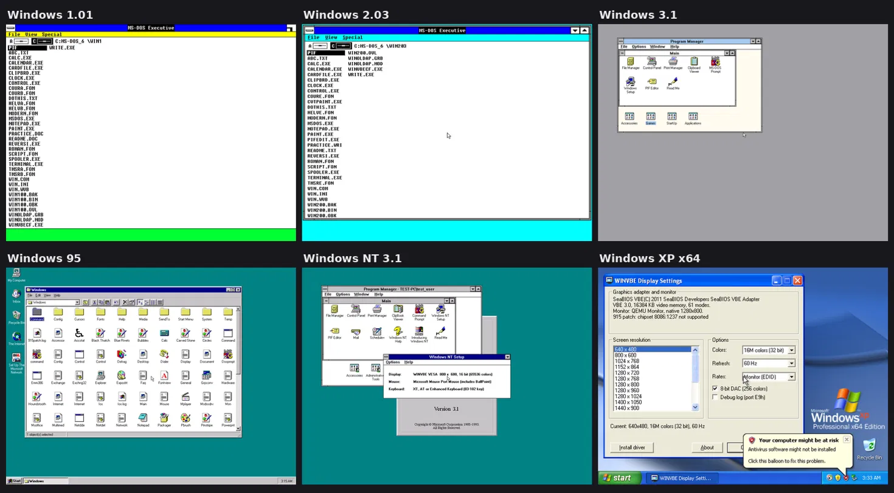

# WINVBE

**One display driver for every Windows from 1.01 to XP x64.**

WINVBE is a universal display driver that drives the graphics card through
its **VESA BIOS Extensions (VBE)** instead of card-specific code, in the
spirit of VBEMP and VBESVGA. The same package runs Windows 1.0x, 2.x, 3.0,
3.1, Windows for Workgroups, Windows 95/98/ME and the Windows NT family up to
XP and Server 2003 x64, at resolutions up to 4096x4096 and colour depths up
to 32 bit. It works with any card that has a VBE BIOS, from an S3 Trio to a
GeForce or Radeon booted with CSM, and with the virtual cards of QEMU, Bochs,
VirtualBox and VMware.




---

## Contents

- [Highlights](#highlights)
- [Supported systems](#supported-systems)
- [Requirements](#requirements)
- [Installation](#installation)
- [Settings](#settings)
- [915PATCH: resolutions for Intel integrated graphics](#915patch-resolutions-for-intel-integrated-graphics)
- [Performance notes](#performance-notes)
- [Known limitations](#known-limitations)
- [Building from source](#building-from-source)
- [Repository layout](#repository-layout)
- [Testing](#testing)

## Highlights

- **Every resolution the BIOS offers.** 640x480 through 3840x2160 and
  beyond, 8/15/16/24/32 bpp, LFB or the banked VGA window (chosen
  automatically). On Bochs, QEMU and VirtualBox adapters any custom size
  is available too.
- **Monitor aware.** It reads EDID over VBE/DDC to get the monitor name,
  native resolution and refresh range, and "Automatic" picks the native
  mode. With a VBE 3.0 BIOS you can set the refresh rate (CVT or
  reduced-blanking timings).
- **Fast on modern cards.** On Windows 3.x and 9x, a shadow frame buffer
  in system memory removes the very slow PCIe reads from video memory, and
  write combining (PAT or MTRR, set up by `WINVBE.386`) sends frame buffer
  writes as bursts.
- **No Windows disks needed.** A DOS installer detects the Windows version
  and installs the matching driver, even linking it into
  `WIN100.BIN`/`WIN200.BIN` for Windows 1.x/2.x. OEMSETUP.INF files are
  included for every Setup that accepts one.
- **Full-screen and windowed MS-DOS boxes**, including the screen switches
  of real cards that the standard VGA virtual display device knows nothing
  about.
- **Windows NT family.** A video miniport plus a frame buffer display
  driver for NT 3.1 - XP, plus a 64-bit build for XP/2003 x64. Features:
  - DirectDraw with page flipping
  - Direct3D (software RGB device) and OpenGL in software
  - DPMS, Stand By and Hibernate
- **Power management** on 3.x/9x/ME: DPMS stand-by/off through VBE/PM
  (WINVBE Power Saver screen saver) and the mode is restored after
  APM/ACPI suspend.
- **VMware SVGA II**: host-accelerated copies and fills, any True Color
  resolution.
- **915PATCH** adds the missing panel/monitor resolutions to the video
  BIOS of Intel 830 ... G45/GM45 and Atom graphics, like `915resolution`.
  It comes as a DOS program, as a VxD and built into the NT miniport.
- **WINVBECF**, one settings program per platform: resolution, colours,
  refresh, memory access, font size and debug log.

## Supported systems

| Windows | Driver | Install with |
|---|---|---|
| 1.01 - 1.04 | `WIN1X\WINVBE.DRV` (real mode) | `INSTALL.EXE`, or patched Setup disks |
| 2.03, 2.1x, Windows/386 2.x | `WIN2X\WINVBE.DRV` | `INSTALL.EXE`, or Setup → *Other* |
| 3.0 (real, standard, 386 enhanced) | `WIN30\WINVBE.DRV` + `WINVBE.386` | `INSTALL.EXE`, DOS Setup → *Other* |
| 3.1, WfW 3.1/3.11 | `WIN31\WINVBE.DRV` + `WINVBE.386` | `INSTALL.EXE`, Setup, or WINVBECF |
| 95, 98, ME | `WIN9X\WINVBE.DRV` + `WINVBE.386` | Device Manager → *Have Disk* |
| NT 3.1, 3.5, 3.51 | `NT\I386\NT3X` miniport + CSRSS display DLL | WINVBECF, or OEMSETUP.INF |
| NT 4.0, 2000, XP, Server 2003 | `NT\I386\NT4-XP` | WINVBECF, *Have Disk*, Device Manager |
| XP x64, Server 2003 x64 | `NT\AMD64` | WINVBECF, Device Manager |

## Requirements

- A graphics card with a **VBE BIOS** (1.2, 2.0 or 3.0). On modern PCs,
  enable **CSM / Legacy boot**: UEFI-only (GOP) firmware has no VBE.
- Turn off **Above 4G decoding / Resizable BAR** where possible. Windows
  3.x/9x cannot reach a frame buffer above 4 GB. WINVBE detects this and
  falls back to the slower VGA window.
- A 386 or later CPU.
- Windows 1.x/2.x run in real mode, so the BIOS must support banked modes
  there.

## Installation

Download the release archive and copy the `WINVBE10` folder to the hard
disk, e.g. `C:\WINVBE10`.

### Windows 1.x, 2.x, 3.0, 3.1 and Windows for Workgroups

Exit Windows and run the DOS installer:

```
C:\WINVBE10\INSTALL
```

INSTALL finds the Windows installations on the hard disks and recognises
their version. It lists the video modes and monitor data, then asks for the
mode, refresh rate and font size. Start Windows with `WIN`.

Unattended use:

```
INSTALL /W:1024 /H:768 /D:16 [/R:75] [/A:0|1|2] [/LARGE] [/DIR:C:\WIN31]
INSTALL /AUTO      monitor native mode
INSTALL /LIST      show modes and monitor information only
INSTALL /VGA       switch back to the original display driver
```

Alternatives on 3.x: run `WINVBECF.EXE` from the `WIN31`/`WIN30` folder
inside Windows, or use Windows Setup with *Other display* and the `WIN31`/`WIN30`
folder (OEMSETUP.INF).

### Windows 95, 98 and ME

1. Device Manager → *Display adapters* → your adapter → *Properties* →
   *Driver* → *Change/Update Driver* → *Have Disk* → the `WIN9X` folder.
2. Choose **WINVBE Universal VESA/VGA/SVGA** and restart.
3. Set resolution and colours in *Display Properties* or with
   `WINVBECF.EXE`, which also covers refresh rate, memory access and custom
   sizes.

### Windows NT

Log on as Administrator and use the folder for your system:

| Folder | Systems |
|---|---|
| `NT\I386\NT3X` | NT 3.1, 3.5, 3.51 |
| `NT\I386\NT4-XP` | NT 4.0, 2000, XP, Server 2003 |
| `NT\AMD64` | XP x64, Server 2003 x64 |

- **All versions:** run `WINVBECF.EXE` from the folder, press **Install
  driver**, then restart.
- **2000 / XP / 2003 / x64:** alternatively Device Manager → *Update
  Driver* → *Have Disk*.
- **NT 4.0:** Display → Settings → *Display Type* → *Change* → *Have Disk*.
- **NT 3.1:** Windows NT Setup → *Change System Settings* → Display →
  *Other* → `NT\I386\NT3X`.
- **NT 3.5/3.51:** Display → *Change Display Type* → *Other*.

WINVBECF keeps the display entry of NT 3.x Setup in step with the mode it
sets.

## Settings

`WINVBECF.EXE` shows the adapter (VBE version, memory, OEM name) and the
monitor (EDID name, native mode, frequency range). It lists the modes and
sets resolution, colours, refresh rate, monitor type (CRT/LCD timings),
memory access (automatic / LFB / VGA window), font size and the debug log.
Its *Active* line shows how the screen is driven, for example
`linear frame buffer + WC + shadow`.

Windows 3.x/9x read their settings from the `[WINVBE]` section of
`SYSTEM.INI`; Windows 1.x/2.x use `WIN.INI`. Frequently used keys:

| Key | Meaning |
|---|---|
| `Width`, `Height`, `Depth` | mode (0 = automatic: EDID native) |
| `Refresh` | 0 = BIOS default, 1 = monitor native, or Hz (VBE 3.0) |
| `Access` | 0 = automatic, 1 = LFB only, 2 = VGA window only |
| `ShadowBuffer` | 1 = shadow frame buffer (386 enhanced mode, 9x) |
| `WriteCombining` | 1 = write-combined frame buffer via `WINVBE.386` |
| `VddMode` | 3.x full-screen DOS help; automatic by default |
| `DPI` | 96 small fonts, 120 large fonts |
| `Debug`, `DebugPort` | log to port E9h (Bochs/QEMU) or a COM port |

The full list is in [README.TXT](README.TXT).

## 915PATCH: resolutions for Intel integrated graphics

The video BIOS of Intel 830, 845G, 852/855GM, 865G, 915G/GM, 945G/GM/GME,
946GZ, G965/Q965/GM965, G31/G33/Q33/Q35, GM45/G41/G43/G45/Q45/B43 and Atom
D4xx/D5xx/N4xx/N5xx graphics has a fixed mode table. Panel resolutions such
as 1280x800, 1440x900 or 1680x1050 are often missing from it. 915PATCH
replaces unused entries with the resolution you need:

```
915PATCH /LIST            chipset, BIOS table type and modes
915PATCH /AUTO            monitor native resolution (EDID)
915PATCH /AUTO 1280 800   a given resolution
915PATCH 5C 1280 800 32   replace one Intel mode
915PATCH /DUMP            save the video BIOS
```

It finds the table by content: all four layouts are supported, including
GM45 tables with EDID-style timings. It only patches tables that look real.
Setup is automatic and happens only on PCs whose BIOS it can patch:
- **DOS INSTALL** adds a line to `AUTOEXEC.BAT`.
- **Windows 95/98/ME** load the silent `915PATCH.VXD`.
- **The NT miniport** applies the patch itself at every start.

## Performance notes

WINVBE draws in software, and on a modern card the bus is the bottleneck.
- **Reads:** uncached reads from video memory cost a full PCIe round trip
  each. Scrolling a 1920x1080x32 window means reading about 8 MB, which
  takes seconds. With the shadow frame buffer (Windows 3.x 386 enhanced
  mode and 9x) all reads come from system memory, so scrolling is limited
  by memory speed instead.
- **Writes:** with write combining, the CPU merges frame buffer writes
  into bursts. `WINVBE.386` uses a free PAT entry for the frame buffer
  mapping (Pentium III / Athlon and later), or a free variable MTRR.
- **NT:** write combining is used on NT 4.0 and later; the GDI engine
  still reads video memory directly.

## Known limitations

- **No hardware 2D/3D acceleration** (except copies and fills on VMware
  SVGA II). Direct3D and OpenGL run on the CPU. VBE has no 3D, and a
  VMware SVGA3D driver would be a project of its own.
- **Windowed graphics-mode DOS programs** on Windows 3.x/9x may not display
  correctly: the standard VGA virtual display device does not know VBE
  modes. Run them full screen. Text-mode DOS boxes are fine in both
  windowed and full-screen mode.
- **No 16-colour planar VBE modes.**
- **Windows 9x** uses WINVBE as a Windows 3.1-style driver: DirectDraw
  runs in emulation on WINVBE's DCI primary surface, and changing the
  resolution needs a restart.
- **The Microsoft files are not in the source tree.** The release package
  carries some Microsoft files (VGA fonts and grabbers, `VDDVGA30.386`)
  so that Windows 3.x Setup needs no disks. They belong to your own
  licensed copy of Windows.

See *Known limitations* in [README.TXT](README.TXT) for details.

## Building from source

Requirements:
- [Open Watcom C 2.0](https://github.com/open-watcom/open-watcom-v2) for
  the 16-bit drivers and tools
- [NASM](https://www.nasm.us/)
- Python 3 (resources, fonts, INF files, LE/NE post-processing)
- for Windows NT: mingw-w64 (i686 and x86_64) and Python's `pefile`

```sh
export WATCOM=/opt/watcom
sh build.sh            # all drivers, tools and the NT files -> bin/
sh nt/build.sh         # Windows NT only
sh hosttest/build.sh   # host unit tests (ASan/UBSan) for the drawing code
```

The NT build checks two things:
- the i386 miniport imports nothing that Windows NT 3.1's `VIDEOPRT.SYS`
  lacks (`nt/tools/chkimp.py`);
- the i386 binaries contain no Pentium Pro instructions, so they run on a
  386/486/Pentium.

## Repository layout

```
drv/        WINVBE.DRV - the 16-bit display driver (Windows 1.x - ME)
vxd/        WINVBE.386 - helper VxD: DOS box screen switches, power
            events, write combining (NASM, flat binary -> LE)
cfg/        WINVBECF.EXE, INSTALL.EXE, WVBPOWER.SCR
patch/      915PATCH.EXE / 915PATCH.VXD and the shared table code
nt/mini/    WINVBE.SYS - NT video miniport (i386 and amd64)
nt/disp/    WINVBE.DLL - NT display driver (NT 3.x CSRSS and NT 4.0+ kernel)
nt/cfg/     WINVBECF.EXE for Windows NT
nt/inf/     WINVBE.INF (NT 4.0 - XP x64) and OEMSETUP.INF (NT 3.x)
res/        generated cursors, icons, bitmaps and fonts
tools/      resource, font, INF and executable-format tools, packaging
hosttest/   unit tests that run the drawing code on Linux
test/       GDI, DCI, DirectDraw, Direct3D and OpenGL test programs
docs/       images for this README
```

## Testing

WINVBE is developed and tested in QEMU (SeaBIOS VBE 3.0 / Bochs DISPI, the
VMware SVGA II adapter, a GM45 video BIOS image for 915PATCH):
- Windows 1.01, 2.03, Windows/386 2.11
- Windows 3.0 in all three modes, Windows 3.1
- Windows 95
- Windows NT 3.1, 3.51, 4.0, 2000 and XP x64

Covered areas:
- every colour depth, LFB and banked access
- full-screen and windowed DOS boxes, including a mode that behaves like a
  real card
- suspend/resume
- DirectDraw, Direct3D and OpenGL
- all installers and Setup paths
- an automated Windows 95 application stress run

Real hardware reports are welcome. Please include the *Active* line and the
adapter box of WINVBECF and, if possible, a `Debug=1` log.
